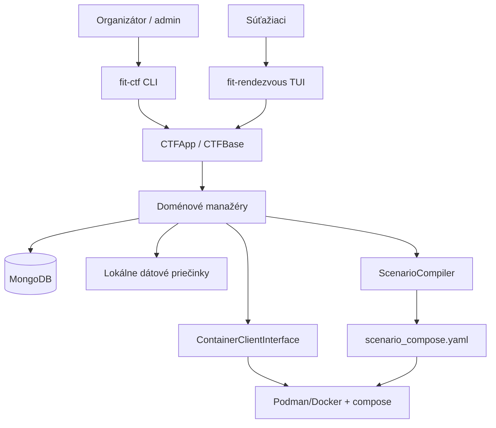
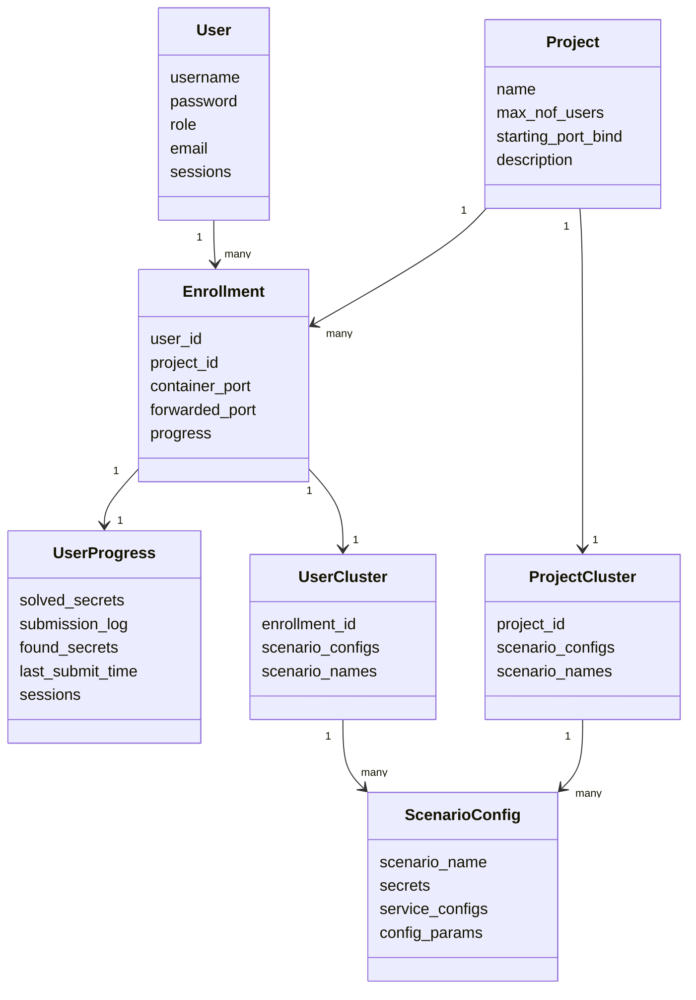
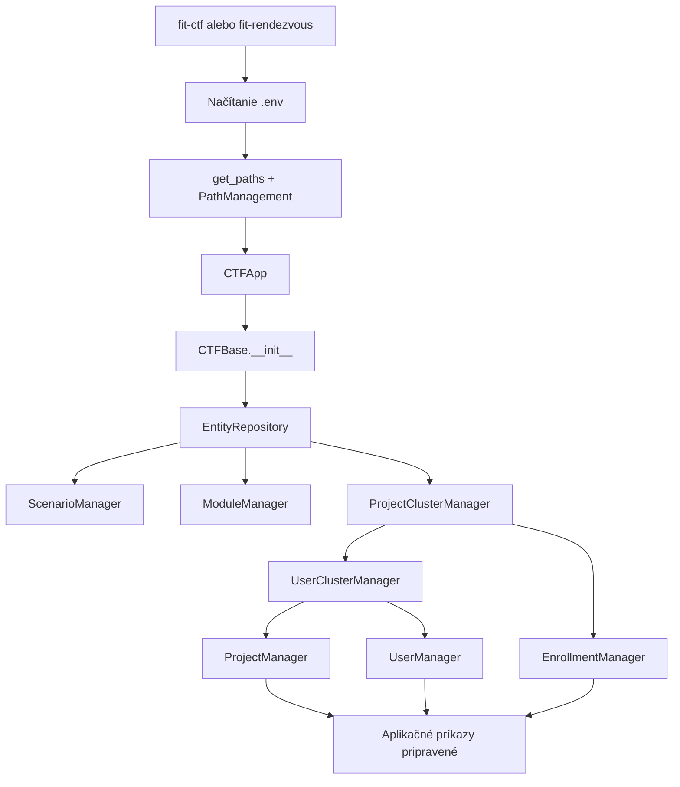
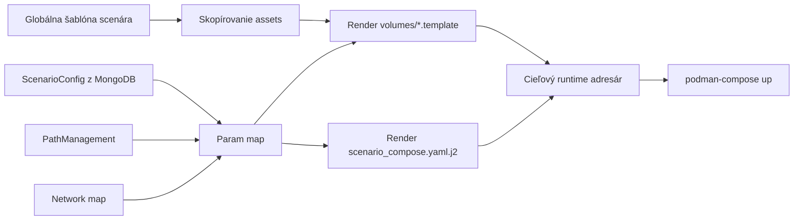
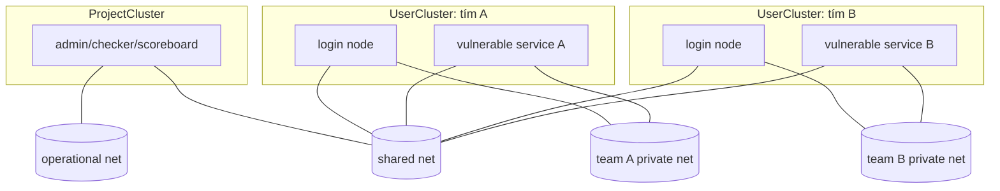
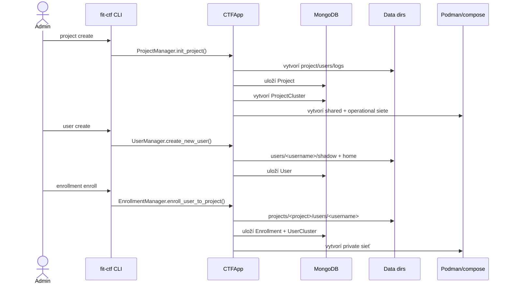
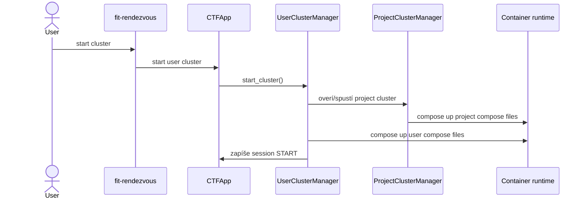
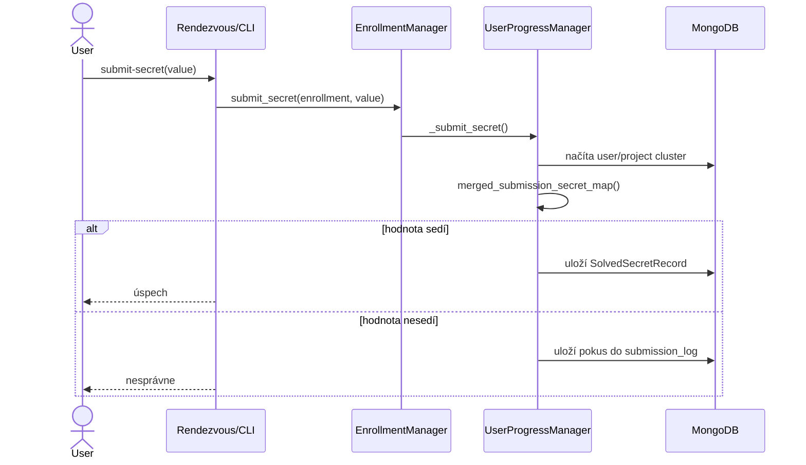

# Architektúra existujúceho frameworku fit-ctf

## 1. Vysoký pohľad

`fit-ctf` je kontajnerovo orientovaný CTF framework postavený nad Python/Poetry,
MongoDB a kontajnerovým runtime, primárne Podman/podman-compose. Projekt má dve
hlavné používateľské rozhrania:

- `fit-ctf` - operátorské CLI pre správu projektov, používateľov, enrollmentov,
  scenárov, klastrov a progresu.
- `fit-rendezvous` - Textual TUI pre súťažiacich, cez ktoré sa prihlásia, vyberú
  projekt, spustia vlastný klaster, nahrajú SSH kľúč a submitujú tajomstvá/flagy.

Jadro je v balíku `src/fit_ctf`. CLI je v `src/fit_ctf_cli` a TUI v
`src/fit_ctf_rendezvous`.



Framework je dnes zameraný hlavne na klasický CTF model: každý používateľ je
zapísaný do projektu, môže mať svoj per-user klaster, rieši scenáre a submituje
statické tajomstvá. Už existuje aj koncept projektového zdieľaného klastra, čo je
veľmi dôležité pre budúci Attack & Defense režim.

## 2. Hlavné moduly v repozitári

Relevantná štruktúra:

```text
src/
  fit_ctf/
    ctf_app.py                 # vysoká aplikačná fasáda
    ctf_base.py                # inicializácia DB, runtime klienta a manažérov
    path_mgmt.py               # centrálna práca s cestami
    components/
      container_client/        # abstrakcia nad Podman/Docker
      data_parser/             # YAML parser + validácia dát
      data_view/               # tabuľkové/CSV výstupy
      schemas/v1/              # YAML/JSON schema kontrakty
    models/
      base.py                  # Base a BaseManager pre Mongo dokumenty
      core/
        project.py             # projekt/súťaž
        user.py                # používateľ a lokálne shadow/home dáta
        enrollment.py          # priradenie používateľa do projektu
        user_progress.py       # submit secretov a leaderboard
        secret.py              # záznam submitnutého tajomstva
        team.py                # základ tímového modelu, dnes neintegrovaný
      infra/
        config_models.py       # ScenarioConfig, ServiceConfig, VolumeConfig
        scenario_manager.py    # správa šablón scenárov
        scenario_compile.py    # render compose + volume templates
        cluster_mgr_mixin.py   # spoločná logika klastrov
        project_cluster.py     # zdieľaný/project-level klaster
        user_cluster.py        # per-user klaster
        module_manager.py      # build modulov/image
      utils/
        repository.py          # zdieľané DB lookupy
        mongo_queries.py       # agregačné pipeline
    templates/v1/
      modules/                 # základné moduly/kontajnery
      scenarios/               # šablóny scenárov
      jinja_templates/         # všeobecné Jinja šablóny
  fit_ctf_cli/
    cli/                       # Click príkazy
  fit_ctf_rendezvous/
    rendezvous_core.py         # TUI aplikačná logika
    widgets/                   # Textual obrazovky a stránky
```

## 3. Doménový model

Najdôležitejšie entity:

- `Project` reprezentuje CTF projekt/súťaž. Má názov, opis, maximálny počet
  používateľov a rozsah portov.
- `User` reprezentuje účet súťažiaceho alebo admina. Pri vytvorení vzniká aj
  lokálny `shadow` súbor a `home` priečinok, ktorý sa neskôr mountuje do login nodu.
- `Enrollment` prepája používateľa s projektom. Drží porty pre SSH/login node a
  `UserProgress`.
- `UserProgress` drží vyriešené tajomstvá, históriu pokusov a sessions.
- `ProjectCluster` je zdieľaný klaster patriaci projektu.
- `UserCluster` je privátny klaster patriaci enrollmentu.
- `ScenarioConfig` opisuje, aké služby, porty, env premenné, volume mapy a tajomstvá
  má konkrétny scenár pri nasadení.



## 4. Inicializácia aplikácie

`CTFBase` vytvára všetky manažéry v pevnom poradí. Najprv vznikne spoločný
`EntityRepository`, potom infra manažéry a potom core manažéry. Poradie je dôležité,
lebo manažéry na seba odkazujú.



`CTFApp.init_tool()` pri štarte skopíruje vstavané moduly a scenáre zo
`src/fit_ctf/templates/v1/` do globálnych používateľských dátových priečinkov, ak tam
ešte nie sú. To znamená, že šablóny z balíka slúžia ako default seed, ale reálne
pracovné scenáre sú v dátovom adresári frameworku.

## 5. Cesty a dátové priečinky

`PathManagement` zjednocuje pomenovanie ciest:

- `projects` - projekty a ich runtime výstupy.
- `users` - globálne používateľské priečinky.
- `modules` - globálne moduly/kontajnerové build kontexty.
- `scenarios` - globálne šablóny scenárov.

Pre projekt vzniká napríklad:

```text
projects/<project>/
  users/<username>/       # enrollment-specific runtime strom
  scenarios/              # skompilované project-level scenáre
  logs/                   # runtime logy

users/<username>/
  shadow
  home/
```

Per-user scenár sa kompiluje do `projects/<project>/users/<username>/<scenario>/`.
Project-level scenár sa kompiluje do `projects/<project>/scenarios/<scenario>/`.

## 6. Scenáre, moduly a kompilácia

Scenár je šablónový adresár. Typicky obsahuje:

```text
scenario_name/
  scenario_compose.yaml.j2
  volumes/
    file.template
  modules/
```

`ScenarioConfig` dopĺňa hodnoty, ktoré sa majú vložiť do šablón:

- `secrets` - logické tajomstvá scenára.
- `service_configs` - konfigurácia služieb.
- `config_params` - voľné parametre scenára.

`ScenarioCompiler` robí tri kroky:

1. Skopíruje `volumes/` a `modules/` zo šablóny do cieľového runtime stromu.
2. Poskladá `param_map` z ciest, sietí, portov, env premenných, volume máp a
   template parametrov.
3. Vyrenderuje `scenario_compose.yaml.j2` do finálneho `scenario_compose.yaml`.

Pri volume template sú tajomstvá dostupné ako `secret_map__<name>`. To umožňuje
vložiť flag do súboru, ktorý bude bind-mountnutý do kontajnera.



## 7. Klastre a siete

Framework rozlišuje dva druhy klastrov:

- `ProjectCluster` - infraštruktúra spoločná pre celý projekt. Má siete:
  `shared` a `operational`.
- `UserCluster` - osobné prostredie jedného súťažiaceho. Má siete:
  `shared` a `private`.

Toto delenie je veľmi dobrý základ pre Attack & Defense:

- `shared` môže slúžiť ako bojová sieť, kde tímy vidia služby ostatných.
- `private` izoluje interné per-user/tímové služby.
- `operational` môže zostať len pre organizátorské komponenty: checker, flag
  rotator, scoreboard, monitoring.



Dnes sa siete vytvárajú pri založení projektu/enrollmentu cez kontajnerový klient.
Compose súbory ich používajú ako externé siete.

## 8. Životný cyklus projektu a používateľa

Typický tok z CLI:



## 9. Životný cyklus spustenia klastra

Pri spustení user klastra sa framework najprv pokúsi zabezpečiť, že project cluster
beží. Potom zavolá `compose_up()` nad zoznamom skompilovaných compose súborov.



## 10. Submit tajomstiev a leaderboard

Tajomstvá sa dnes validujú takto:

1. Enrollment obsahuje `UserProgress`.
2. Pri submite sa načíta user cluster aj project cluster.
3. Z ich `ScenarioConfig.secrets` sa vytvorí zjednotená mapa submitovateľných tajomstiev.
4. Hodnota od používateľa sa porovná proti tejto mape.
5. Pri zhode sa uloží `SolvedSecretRecord`, zvýši sa `found_secrets` a aktualizuje
   sa `last_submit_time`.
6. Leaderboard sa skladá cez MongoDB agregáciu a dopĺňa sa o počet všetkých
   submitovateľných slotov.



Pre klasický Jeopardy-like CTF je toto dostačujúce. Pre Attack & Defense však bude
treba rozšíriť model o to, komu flag patrí, kto ho ukradol, v ktorom ticku bol
platný a či bol submitnutý v povolenom časovom okne.

## 11. Silné stránky existujúcej architektúry

- Existuje jasné oddelenie aplikačnej fasády, doménových manažérov, dátových modelov,
  šablón a runtime klienta.
- `ScenarioCompiler` už rieši renderovanie kontajnerovej infraštruktúry z deklaratívnej
  konfigurácie.
- `ProjectCluster` a `UserCluster` sú presne ten základ, ktorý A&D potrebuje:
  shared infraštruktúra plus per-team služby.
- Secret/flag mechanizmus už existuje a je napojený na UI, CLI aj leaderboard.
- Kontajnerový klient je abstrahovaný, takže nové runtime operácie sa dajú pridávať
  bez toho, aby sa doménová logika viazala priamo na Podman.

## 12. Limity pre Attack & Defense

Dnešná architektúra ešte nerieši:

- tím ako prvotriednu entitu v enrollmentoch,
- tick-based čas,
- dynamické generovanie a rotáciu flagov,
- atribúciu flagu: vlastník služby vs. útočník,
- kontrolu dostupnosti/služby checkerom,
- scoring vzorec Attack & Defense,
- rate limiting a validitu flagov v čase,
- sieťové pravidlá pre bojovú sieť,
- scoreboard oddelený od klasického leaderboardu.

Tieto limity sa však dajú doplniť ako rozšírenie nad existujúcimi vrstvami, nie ako
kompletný rewrite.
