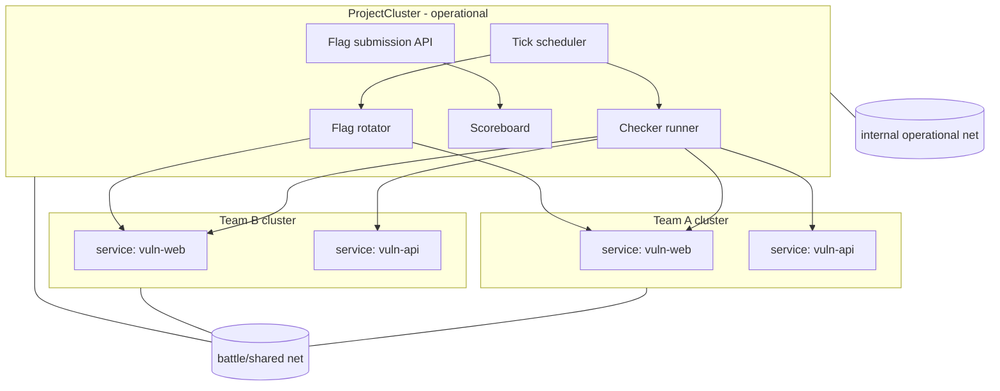
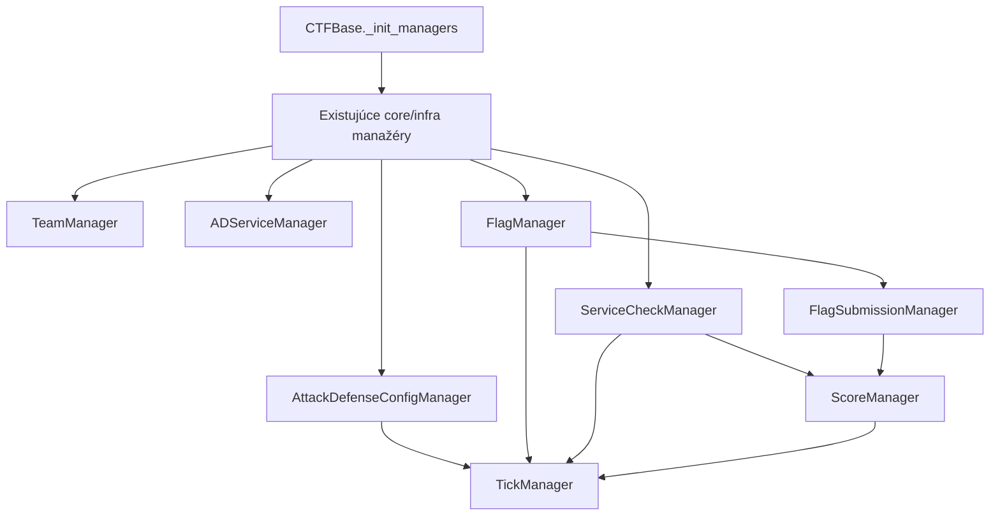
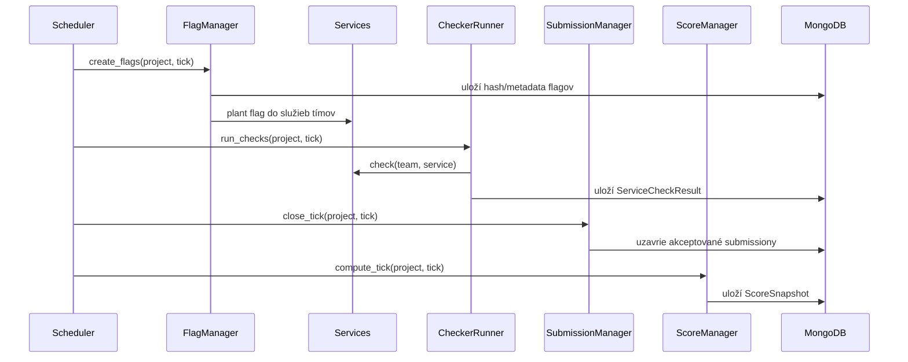
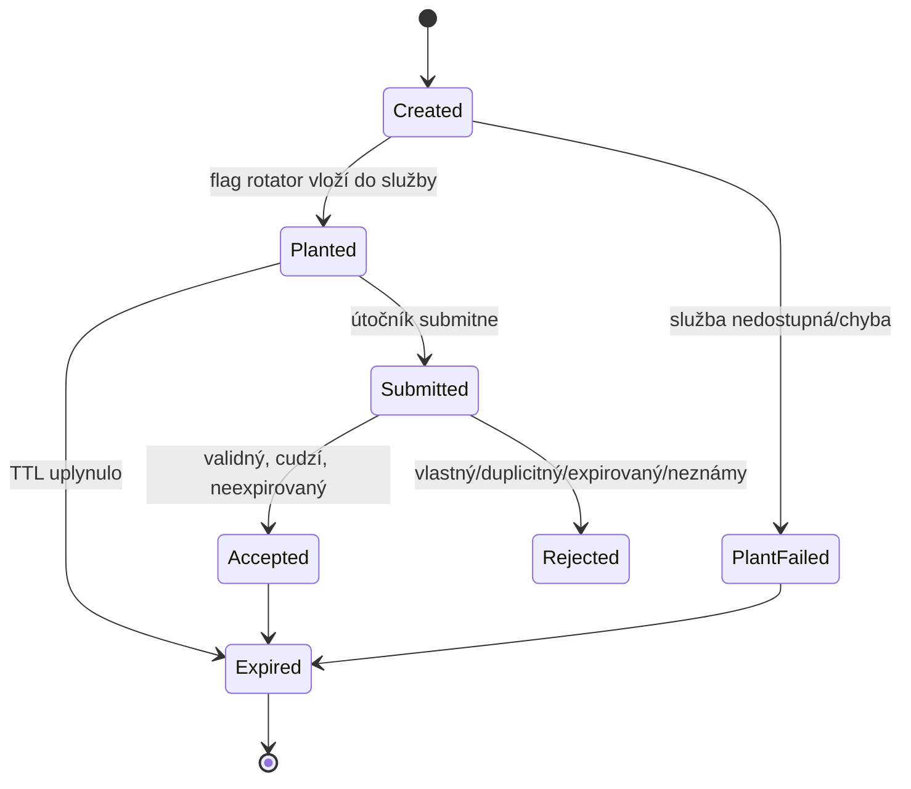
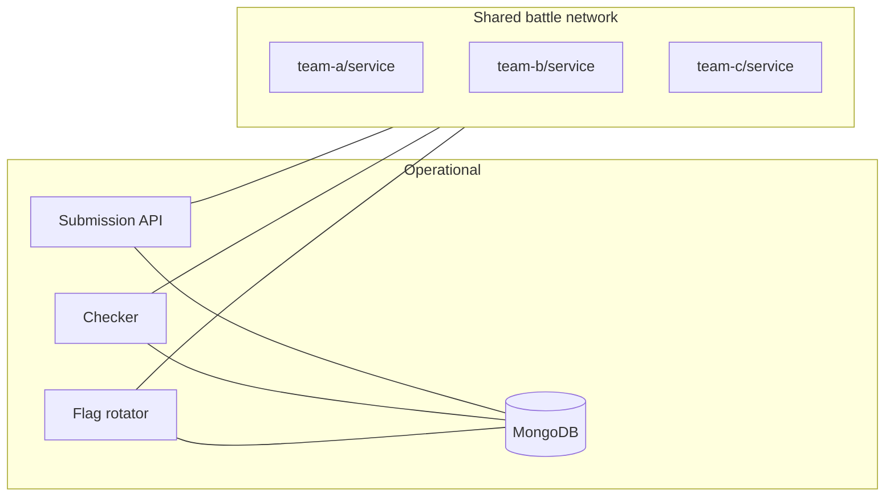

# Návrh Attack & Defense režimu

## 1. Cieľ návrhu

Cieľom je doplniť do `fit-ctf` režim Attack & Defense tak, aby:

- využil existujúcu kontajnerovú infraštruktúru, scenáre, klastre a submit mechanizmus,
- nerozbil klasický CTF režim,
- umožnil tímom prevádzkovať vlastné zraniteľné služby,
- pravidelne kontroloval dostupnosť služieb,
- pravidelne vkladal nové flagy do služieb,
- prijímal ukradnuté flagy od útočiacich tímov,
- počítal skóre podľa útoku, obrany a SLA.

Návrh predpokladá inkrementálny vývoj: najprv minimálne funkčné jadro, potom lepšie
scoreboardy, izolácia, monitoring a UX.

## 2. Základná idea

Attack & Defense režim bude špeciálny typ projektu. Projekt bude mať tímy, každý tím
dostane vlastný `UserCluster` alebo jeho tímový variant. V tomto klastri pobežia
rovnaké zraniteľné služby pre každý tím. Organizátorské komponenty pobežia v
`ProjectCluster`.



## 3. Čo ponechať a čo rozšíriť

Ponechať:

- `Project` ako základ súťaže.
- `ScenarioConfig`, `ServiceConfig`, `VolumeConfig` ako deklaratívny popis služieb.
- `ScenarioCompiler` ako generátor compose súborov.
- `ProjectCluster` pre organizátorské komponenty.
- `UserCluster` ako východiskový model pre izolované tímové inštancie.
- `ContainerClientInterface` pre spúšťanie, zastavovanie a logy.

Rozšíriť:

- doménový model o A&D entitné kolekcie,
- spôsob enrollmentu tak, aby podporoval tím,
- flag mechanizmus z "statický secret" na "rotujúci flag s ownerom a tickom",
- leaderboard na scoring engine,
- CLI/TUI o A&D príkazy a pohľady,
- scenáre o metadáta služby a checker kontrakt.

## 4. Navrhované nové entity

### `AttackDefenseProjectConfig`

Konfigurácia A&D režimu pre projekt.

```python
class AttackDefenseProjectConfig(Base):
    project_id: DBRef
    enabled: bool
    tick_seconds: int
    flag_ttl_ticks: int
    attack_points: float
    defense_points: float
    sla_points: float
    start_time: datetime | None
    end_time: datetime | None
```

Prečo samostatne a nie priamo v `Project`:

- zachová sa kompatibilita klasických projektov,
- A&D parametre sú voliteľné,
- dá sa pridať bez migrácie všetkých existujúcich projektov.

### `Team`

V repozitári už existuje `src/fit_ctf/models/core/team.py`, ale dnes nie je napojený
do enrollment toku. Pre A&D by tím mal byť prvotriedny objekt.

```python
class Team(Base):
    name: str
    display_name: str
    members: list[DBRef]      # user refs
    captain_id: DBRef | None
```

Možnosti integrácie:

- krátkodobo: tím reprezentovať jedným technickým `User` účtom a mapovať členov mimo
  scoringu,
- dlhodobo: rozšíriť `Enrollment` o `team_id` a povoliť `user_id` alebo `team_id`.

Odporúčanie: pre čistý A&D návrh doplniť `team_id` do `Enrollment`, ale implementovať
to spätne kompatibilne.

### `TeamCluster`

Sú dve možnosti:

1. Použiť existujúci `UserCluster` pre tímový účet.
2. Zaviesť `TeamCluster` odvodený od rovnakej logiky ako `UserCluster`.

Odporúčanie:

- MVP: použiť `UserCluster` s technickým tímovým používateľom.
- Finálna verzia: zaviesť `TeamCluster`, ktorý dedí koncepty z `ClusterManagerMixin`.

Dôvod: A&D bude neskôr potrebovať tímové názvy, členov, scoring a sieťové pravidlá.
Technický user účet je dobrý na rýchle overenie, ale nie ako dlhodobý doménový model.

### `ServiceDefinition`

Scenár dnes opisuje kontajnery, ale A&D potrebuje vedieť, ktorá služba je súťažná,
ako sa kontroluje a ako sa do nej vkladá flag.

```python
class ServiceDefinition(Base):
    project_id: DBRef
    scenario_name: str
    service_name: str
    checker_name: str
    flag_locations: list[FlagLocation]
    public_port_key: str | None
    enabled: bool
```

### `Flag`

Rotujúci flag musí niesť vlastníka a časovú platnosť.

```python
class Flag(Base):
    project_id: DBRef
    owner_team_id: DBRef
    service_name: str
    scenario_name: str
    tick: int
    value_hash: str
    value_encrypted: str | None
    valid_from: datetime
    valid_until: datetime
    planted_at: datetime | None
```

Poznámka: v DB by nemal byť flag v plain texte, ak to nie je nutné. Submission sa dá
validovať hashom. Plain/encrypted hodnota môže byť dostupná len flag rotatoru.

### `FlagSubmission`

Submission v A&D nie je "našiel som vlastný secret", ale "tím X submitol flag tímu Y".

```python
class FlagSubmission(Base):
    project_id: DBRef
    attacker_team_id: DBRef
    victim_team_id: DBRef
    service_name: str
    flag_id: DBRef
    tick: int
    submitted_at: datetime
    accepted: bool
    reason: str
```

Validácia musí odmietnuť:

- neexistujúci flag,
- expirovaný flag,
- vlastný flag,
- duplicitný submit rovnakým tímom,
- flag mimo projektu/služby,
- submit po skončení kola.

### `ServiceCheckResult`

Checker musí zapisovať dostupnosť a korektnosť služby.

```python
class ServiceCheckResult(Base):
    project_id: DBRef
    team_id: DBRef
    service_name: str
    tick: int
    status: Literal["up", "down", "mumble", "checker_error"]
    message: str
    checked_at: datetime
    latency_ms: int | None
```

### `ScoreSnapshot`

Scoreboard by nemal pri každom refreshi prepočítavať všetko od začiatku. Raz za tick
sa môže uložiť snapshot.

```python
class ScoreSnapshot(Base):
    project_id: DBRef
    team_id: DBRef
    tick: int
    attack_score: float
    defense_score: float
    sla_score: float
    total_score: float
    rank: int
```

## 5. Navrhovaná architektúra manažérov

Nové manažéry by mali nasledovať existujúci štýl `BaseManager`.

```text
src/fit_ctf/models/ad/
  project_config.py       # AttackDefenseProjectConfigManager
  team.py                 # TeamManager alebo rozšírenie core TeamManager
  service_definition.py   # A&D metadáta služieb
  flag.py                 # FlagManager
  submission.py           # FlagSubmissionManager
  checker.py              # ServiceCheckManager / CheckerRunner
  scoring.py              # ScoreManager
  tick.py                 # TickManager / Scheduler
```

Napojenie do `CTFBase._init_managers()`:



## 6. Tick lifecycle

Tick je základná časová jednotka A&D súťaže. Každý tick by mal mať deterministický
priebeh:

1. Vypočítať číslo aktuálneho ticku.
2. Vygenerovať nové flagy pre každý tím a službu.
3. Vložiť flagy do služieb.
4. Spustiť checkery pre každý tím a službu.
5. Uzavrieť prijaté submissiony za predchádzajúci/aktuálny tick.
6. Prepočítať skóre a uložiť snapshot.



## 7. Flag lifecycle

Flag vzniká pre konkrétny tím, službu a tick. Je vložený do služby obete. Iný tím ho
môže získať útokom a submitnúť cez API/CLI/TUI.



## 8. Flag planting

Sú tri realistické prístupy:

### A. File-based planting cez bind mount

Flag rotator prepíše súbor v tímovom runtime adresári, ktorý je bind-mountnutý do
kontajnera.

Výhody:

- dobre sedí na existujúce `volumes/*.template`,
- jednoduché na implementáciu,
- netreba agent v kontajneri.

Nevýhody:

- nie každá služba vie flag čítať zo súboru,
- pri niektorých službách treba reload.

### B. HTTP/API planting

Každá súťažná služba vystaví interný endpoint pre checker/flag rotator.

Výhody:

- realistické pre web/API služby,
- checker vie overiť aj stav aplikácie.

Nevýhody:

- treba definovať kontrakt,
- riziko, že endpoint unikne do bojovej siete, ak sa zle oddelia siete.

### C. Exec planting cez kontajnerový runtime

Flag rotator zavolá `podman exec` alebo compose exec do služby a vloží flag príkazom.

Výhody:

- flexibilné,
- netreba verejný endpoint.

Nevýhody:

- runtime klient dnes nemá čistú všeobecnú metódu pre exec proti konkrétnemu kontajneru,
- náročnejšie na bezpečnosť a logovanie.

Odporúčanie:

- MVP: file-based planting pre prvý prototyp.
- Neskôr: API planting ako odporúčaný kontrakt pre A&D scenáre.

## 9. Checker kontrakt

Checker by mal byť samostatný modul alebo kontajner. Vstup dostane cez env/argv:

```text
CHECK_TARGET_HOST=<team-service-host>
CHECK_TARGET_PORT=<port>
TEAM_NAME=<team>
SERVICE_NAME=<service>
TICK=<tick>
FLAG_VALUE=<voliteľné pri put/get kontrole>
```

Výstup checkeru by mal byť strojovo čitateľný JSON:

```json
{
  "status": "up",
  "message": "service accepted flag and returned expected response",
  "latency_ms": 42
}
```

Statusy:

- `up` - služba funguje.
- `down` - služba nedostupná.
- `mumble` - služba odpovedá, ale nesprávne.
- `checker_error` - zlyhal checker, nie služba.

Checker by mal bežať z `ProjectCluster` cez `operational` sieť alebo cez izolovaný
organizátorský kontajner pripojený aj do `shared`.

## 10. Sieťový model

Minimálne potrebné siete:

- `shared` - bojová sieť, tímové služby sú dostupné ostatným tímom.
- `private` - interná sieť tímu, napríklad login node a interné komponenty.
- `operational` - iba organizátorské služby, checker, rotator, DB-facing API.

Odporúčané pravidlá:

- MongoDB nikdy nedávať do `shared`.
- Submission API vystaviť súťažiacim, ale DB držať za ním.
- Checker/rotator mať v `operational`, s kontrolovaným prístupom do tímových služieb.
- Tímové služby pomenovať deterministicky, napríklad
  `<project>_<team>_<scenario>_<service>`.



## 11. Submission API

Dnes submit funguje cez CLI/TUI a priamu Python doménovú logiku. Pre A&D je vhodné
mať aj jednoduché HTTP API, pretože tímy budú submitovať veľa flagov automatizovane.

Minimálne endpointy:

```text
POST /api/ad/submit
GET  /api/ad/scoreboard
GET  /api/ad/status
```

Príklad submit requestu:

```json
{
  "team_token": "token...",
  "flag": "FITCTF{...}"
}
```

Validácia:

1. Autentifikovať tím podľa tokenu.
2. Nájsť flag podľa hash hodnoty.
3. Overiť projekt a časovú platnosť.
4. Odmietnuť vlastný flag.
5. Odmietnuť duplicitu pre rovnaký útočiaci tím.
6. Uložiť `FlagSubmission`.
7. Vrátiť dôvod prijatia/odmietnutia.

CLI/TUI môže nad tým zostať ako pohodlná vrstva, ale automatizované exploit skripty
budú používať API.

## 12. Scoring

Základné zložky:

- Attack score: body za úspešne submitnuté cudzie flagy.
- Defense score: body za to, že vlastná služba bola dostupná a flagy boli správne
  zasadené/overiteľné.
- SLA score: dlhodobejšia dostupnosť služby.

Jednoduchý MVP vzorec:

```text
total = attack_score + defense_score + sla_score

attack_score(team, tick) =
  accepted_foreign_flags_submitted_by_team * attack_points

defense_score(team, tick) =
  up_services_for_team * defense_points

sla_score(team) =
  (up_checks / total_checks) * sla_points
```

Neskôr možno doplniť dynamické váhy:

- čím viac tímov ukradne rovnaký flag, tým menšia hodnota,
- útok na silnú službu môže mať vyššiu váhu,
- defense penalizácia pri opakovanej nedostupnosti,
- first blood bonus.

## 13. Kompatibilita s existujúcim leaderboardom

Klasický `project leaderboard` dnes počíta `found_secrets`. Pre A&D odporúčam nový
samostatný príkaz:

```text
fit-ctf ad scoreboard --project-name <project>
```

Dôvod:

- klasický leaderboard má inú sémantiku,
- A&D skóre je tick-based a skladá sa z viacerých komponentov,
- nechceme meniť význam existujúcich príkazov pre klasické CTF.

## 14. Rozšírenie CLI

Navrhované príkazy:

```text
fit-ctf ad init --project-name p --tick-seconds 120
fit-ctf ad team create --project-name p --team-name team_a
fit-ctf ad service add --project-name p --scenario vuln --service web --checker web_checker
fit-ctf ad start --project-name p
fit-ctf ad stop --project-name p
fit-ctf ad tick --project-name p --once
fit-ctf ad submit --project-name p --team team_a --flag FITCTF{...}
fit-ctf ad scoreboard --project-name p
fit-ctf ad checks --project-name p --tick latest
```

V existujúcom CLI by pribudla lazy-loaded skupina `ad`.

## 15. Rozšírenie Rendezvous

Pre súťažiacich by TUI malo doplniť:

- zobrazenie tímu a team tokenu,
- stav vlastných služieb,
- A&D scoreboard,
- submit flagu,
- prípadne jednoduché logy vlastného tímového klastra.

Automatizovaný submit však musí byť riešený cez API, nie len cez TUI.

## 16. Zmeny v scenároch

A&D scenár by mal mať okrem compose šablóny aj metadáta, napríklad:

```yaml
ad:
  services:
    web:
      checker: web_checker
      flag_planting:
        mode: file
        path: "/var/lib/service/flag.txt"
      public:
        network: shared
        port_key: http
```

Možno to uložiť ako:

- nový `ad.yaml` v adresári scenára,
- alebo rozšírenie existujúcej YAML konfigurácie pri `add-scenario`.

Odporúčanie: nový `ad.yaml`, lebo je to vlastnosť šablóny služby, nie konkrétnej
inštancie.

## 17. MVP plán

### Fáza 1: Doménové jadro

- pridať A&D config ku projektu,
- pridať tímový model alebo technické tímové user účty,
- pridať `Flag`, `FlagSubmission`, `ServiceCheckResult`,
- pridať basic `ScoreManager`.

### Fáza 2: Tick a flagy

- implementovať tick výpočet,
- generovať flagy pre každý tím/službu,
- file-based planting do runtime stromu,
- validovať submity cez hash.

### Fáza 3: Checker

- definovať checker kontrakt,
- spúšťať checker pre každý tím/službu,
- ukladať výsledky,
- prepojiť výsledky so scoringom.

### Fáza 4: CLI a API

- pridať `fit-ctf ad` príkazy,
- pridať HTTP submission API pre exploit skripty,
- pridať scoreboard endpoint.

### Fáza 5: UX a robustnosť

- doplniť Rendezvous pohľady,
- doplniť monitoring a logy,
- doplniť rate limiting,
- doplniť export/import A&D dát.

## 18. Najmenší zmysluplný prototyp

Ak má byť cieľom rýchlo ukázať funkčný vertical slice, stačí:

1. Jeden projekt v A&D režime.
2. Dva tímy ako technickí používatelia.
3. Jeden jednoduchý web scenár pre každý tím.
4. File-based flag planting.
5. Jeden checker, ktorý overí HTTP endpoint.
6. CLI submit flagu.
7. CLI scoreboard z `FlagSubmission` a `ServiceCheckResult`.

Tento prototyp overí všetky rizikové miesta:

- či sa dá per-team služba dobre nasadiť cez existujúci `UserCluster`,
- či flag rotácia vie meniť stav služby,
- či checker vie prístupovať do tímových služieb,
- či scoring model dáva zmysel,
- či je potrebný nový `TeamCluster`, alebo dočasne stačí `UserCluster`.

## 19. Riziká a rozhodnutia na diskusiu

Otázky pre vedúceho:

- Má byť tím prvotriedna entita hneď od začiatku, alebo stačí MVP cez technický user?
- Má framework obsahovať vlastné HTTP API, alebo má zostať len CLI/TUI?
- Aký scoring sa očakáva: jednoduchý statický, alebo dynamický podľa počtu submitov?
- Majú byť služby na shared sieti prístupné všetkým tímom priamo?
- Má checker bežať ako kontajner, Python plugin, alebo externý proces?
- Stačí file-based planting pre prvú verziu?

Moje odporúčanie:

- Pre architektúru navrhnúť čistý tímový model.
- Pre implementačný prototyp začať cez existujúci `UserCluster`.
- Checker a flag rotator dať do `ProjectCluster`.
- Submission API riešiť skoro, lebo A&D bez automatizovaného submitu nebude praktické.

## 20. Prečo návrh sedí na existujúci framework

Návrh sa opiera o existujúce časti namiesto rewrite:

- Project zostáva kontajner súťaže.
- UserCluster/ProjectCluster už vyjadrujú súkromné a zdieľané prostredie.
- ScenarioCompiler už vie vyrábať compose infraštruktúru z konfigurácie.
- Secret mechanizmus už ukazuje, ako napojiť flag-like dáta na MongoDB, CLI, TUI a
  leaderboard.
- ContainerClientInterface už izoluje runtime operácie od doménovej logiky.

Najväčšia zmena nie je v nasadzovaní kontajnerov, ale v doménovej vrstve: flag už
nebude statický cieľ jedného používateľa, ale časovo platný objekt medzi vlastníkom
a útočníkom.
