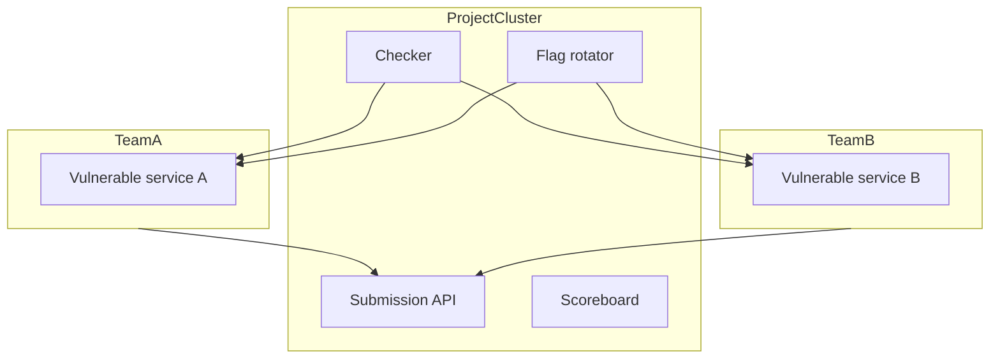

# Návod: ako postupovať pri vlastnom návrhu Attack & Defense režimu

Tento súbor je pracovný návod. Jeho cieľ nie je dať ti hotový návrh, ale viesť ťa
k tomu, aby si si návrh poskladal sám, vedel vysvetliť rozhodnutia a vedel obhájiť,
prečo navrhuješ práve takú architektúru.

## 1. Začni cieľom, nie implementáciou

Najprv si jednou vetou napíš, čo má rozšírenie dosiahnuť.

Príklad:

> Chcem rozšíriť fit-ctf o Attack & Defense režim, v ktorom tímy prevádzkujú vlastné
> služby, útočia na služby ostatných tímov, pravidelne dostávajú nové flagy a skóre sa
> počíta podľa útoku, obrany a dostupnosti.

Potom si dopíš tri obmedzenia:

- nechcem rozbiť existujúci klasický CTF režim,
- chcem využiť existujúce klastre, scenáre a kontajnerový runtime,
- chcem začať minimálnym prototypom, nie veľkým rewrite.

Toto je dôležité, lebo každé ďalšie rozhodnutie potom vieš hodnotiť podľa toho, či
pomáha cieľu alebo zbytočne komplikuje systém.

## 2. Popíš súčasný systém vlastnými slovami

Pred návrhom si musíš vedieť vysvetliť, čo už framework robí. Nepouži hneď detaily
kódu. Najprv si to napíš doménovo:

- `Project` je súťaž.
- `User` je účet.
- `Enrollment` je priradenie používateľa do projektu.
- `UserCluster` je osobné prostredie používateľa.
- `ProjectCluster` je zdieľané prostredie projektu.
- `ScenarioConfig` hovorí, aké služby a tajomstvá sa majú nasadiť.
- `ScenarioCompiler` z toho vyrobí compose súbory.
- `ContainerClientInterface` to spustí cez Podman/Docker.

Potom si odpovedz:

1. Ktoré časti môžem použiť bez zmien?
2. Ktoré časti musím rozšíriť?
3. Ktorým častiam sa chcem radšej vyhnúť, lebo by znamenali rewrite?

Odporúčaná odpoveď:

- Bez zmien: projekty, scenáre, compiler, runtime klient.
- Rozšíriť: doménový model, flagy, scoring, checker, CLI/API.
- Vyhnúť sa: prepisovaniu celého deployment modelu.

## 3. Urči hlavné objekty Attack & Defense

Teraz si vypíš, aké nové veci v A&D existujú, ktoré v klasickom CTF neexistujú alebo
majú iný význam.

Minimálny zoznam:

- tím,
- služba,
- tick,
- flag,
- checker výsledok,
- submission,
- skóre.

Pre každý objekt si odpovedz na štyri otázky:

```text
Čo objekt reprezentuje?
Komu patrí?
Kedy vzniká?
Kto ho číta alebo mení?
```

Príklad pre flag:

```text
Čo reprezentuje?
  Časovo platný tajný token vložený do služby jedného tímu.

Komu patrí?
  Patrí obeti, teda tímu, do ktorého služby bol vložený.

Kedy vzniká?
  Na začiatku ticku pre každú dvojicu tím + služba.

Kto ho číta alebo mení?
  Vytvára ho FlagManager, vkladá FlagRotator, validuje SubmissionManager.
```

Keď toto vieš povedať pre každý objekt, návrh začne byť omnoho jasnejší.

## 4. Rozhodni sa, čo bude MVP

MVP znamená najmenšia verzia, ktorá ukáže celý princíp od začiatku po koniec.

Nepýtaj sa najprv, čo všetko by systém raz mohol vedieť. Spýtaj sa:

> Aký najmenší prototyp dokáže ukázať, že A&D režim v tomto frameworku dáva zmysel?

Odporúčaný MVP rozsah:

- jeden projekt v A&D režime,
- dva tímy,
- jedna zraniteľná služba pre každý tím,
- jeden tick scheduler,
- generovanie flagov,
- file-based planting,
- jednoduchý checker,
- CLI submit flagu,
- jednoduchý scoreboard.

Veci mimo MVP:

- webový realtime scoreboard,
- dynamické váhy scoringu,
- viac služieb,
- first blood bonus,
- zložité sieťové ACL,
- plný tímový permission model,
- pekné TUI obrazovky.

Pri prezentácii je dobré povedať:

> Navrhujem cieľovú architektúru čisto, ale implementáciu by som začal cez úzky
> vertical slice.

## 5. Navrhni dátový model

Pri dátovom modeli postupuj od udalostí, nie od tabuliek.

Napíš si, čo sa v súťaži deje:

1. Organizátor zapne A&D režim pre projekt.
2. Organizátor vytvorí tímy.
3. Tímom sa nasadia služby.
4. Začne tick.
5. Do služieb sa vložia flagy.
6. Checker overí služby.
7. Tímy submitujú ukradnuté flagy.
8. Systém spočíta skóre.

Z toho ti prirodzene vyjdú kolekcie:

```text
ad_project_config
team
ad_service_definition
flag
flag_submission
service_check_result
score_snapshot
```

Pre každú kolekciu si dopíš minimálne polia.

Nepíš hneď všetko možné. Píš len to, čo potrebuješ pre MVP. Potom pridaj sekciu
"neskôr".

Príklad:

```text
Flag:
  project_id
  owner_team_id
  service_name
  tick
  value_hash
  valid_from
  valid_until

Neskôr:
  encrypted_value
  planted_at
  planting_status
```

Tým ukážeš, že vieš držať návrh pri zemi.

## 6. Navrhni runtime architektúru

Tu si odpovedz, kde bude čo bežať.

Použi existujúce delenie:

- `ProjectCluster` - organizátorské služby,
- `UserCluster` alebo budúci `TeamCluster` - služby tímov,
- `shared` sieť - bojová sieť,
- `private` sieť - interná tímová sieť,
- `operational` sieť - interná organizátorská sieť.

Odporúčaný návrh:

```text
ProjectCluster:
  checker runner
  flag rotator
  submission API
  scoreboard

Team/UserCluster:
  vulnerable service
  optional login node
```

Potom si nakresli jednoduchý diagram:



Pri obhajobe zdôrazni:

> Deployment model nemením, len mu dávam A&D význam.

## 7. Rozhodni sa, ako bude fungovať tick

Tick je najdôležitejšia časová jednotka. Navrhni ho presne.

Napíš si:

```text
Dĺžka ticku:
  napríklad 120 sekúnd

Na začiatku ticku:
  vygenerujú sa nové flagy
  vložia sa do služieb

Počas ticku:
  tímy útočia a submitujú flagy
  checker overuje dostupnosť

Na konci ticku:
  uzavrú sa submissiony
  prepočíta sa skóre
```

Potom si vyber, či checker pobeží:

- raz za tick,
- viackrát za tick,
- priebežne mimo tickov.

Pre MVP odporúčam:

> Checker beží raz za tick pre každú dvojicu tím + služba.

Je to ľahko vysvetliteľné a stačí to na prvú verziu.

## 8. Navrhni flag lifecycle

Použi tento sled:

```text
created -> planted -> submitted -> accepted/rejected -> expired
```

Presne si definuj pravidlá validácie:

Flag je accepted, ak:

- existuje,
- patrí do rovnakého projektu,
- ešte neexpiroval,
- nepatrí submitujúcemu tímu,
- tento tím ho ešte nesubmitol,
- súťaž stále beží.

Flag je rejected, ak:

- je neznámy,
- je vlastný,
- je expirovaný,
- je duplicitný,
- je mimo projektu,
- submit prišiel po skončení súťaže.

Toto je veľmi dobrá časť na prezentáciu, lebo ukazuje, že rozmýšľaš nad pravidlami,
nie len nad triedami.

## 9. Rozhodni sa, ako sa budú flagy vkladať do služieb

Máš tri možnosti:

```text
file-based planting
API planting
exec planting
```

Porovnaj ich:

| Spôsob | Výhoda | Nevýhoda | Vhodné pre MVP |
|---|---|---|---|
| file-based | jednoduché, sedí na volumes | nie každá služba to vie použiť | áno |
| API | realistické pre web služby | treba kontrakt a bezpečnosť | neskôr |
| exec | flexibilné | zložitejšie a runtime-dependent | neskôr |

Odporúčaná veta:

> Pre MVP by som zvolil file-based planting, pretože framework už pracuje s volume
> template súbormi. Do cieľovej architektúry by som však počítal aj s API plantingom.

## 10. Navrhni checker kontrakt

Checker musí byť vymeniteľný. Nenavrhuj checker ako hardcoded Python funkciu pre jednu
službu. Navrhni kontrakt.

Vstup:

```text
team
service
host
port
tick
optional flag
```

Výstup:

```json
{
  "status": "up",
  "message": "ok",
  "latency_ms": 31
}
```

Statusy:

```text
up
down
mumble
checker_error
```

Potom vysvetli význam:

- `up` znamená služba funguje správne,
- `down` znamená nedostupná,
- `mumble` znamená odpovedá, ale nesprávne,
- `checker_error` znamená chyba checkeru, nie nutne tímu.

## 11. Navrhni scoring

Začni jednoducho. Nepotrebuješ hneď profesionálny scoring ako veľké A&D súťaže.

MVP:

```text
total = attack + defense + sla
```

Definuj:

```text
attack:
  body za cudzie akceptované flagy

defense:
  body za službu, ktorá bola v ticku up

sla:
  percento dostupnosti za celú súťaž
```

Potom dopíš, čo by sa dalo zlepšiť neskôr:

- dynamická hodnota flagu,
- first blood bonus,
- penalizácia za down službu,
- váha služby podľa obtiažnosti,
- normalizácia skóre podľa počtu tímov.

Pri návrhu si dávaj pozor:

- nepočítaj body za vlastný flag,
- nerátaj duplicitné submity,
- maj auditovateľné snapshoty skóre,
- scoring by mal byť deterministický pre rovnaké vstupy.

## 12. Navrhni používateľské rozhranie

Rozdeľ používateľov:

```text
Organizátor:
  CLI

Tím:
  API + prípadne Rendezvous
```

Pre organizátora navrhni CLI:

```text
fit-ctf ad init
fit-ctf ad team create
fit-ctf ad service add
fit-ctf ad start
fit-ctf ad stop
fit-ctf ad tick --once
fit-ctf ad scoreboard
fit-ctf ad checks
```

Pre tím:

```text
POST /api/ad/submit
GET /api/ad/scoreboard
GET /api/ad/status
```

Vysvetli, prečo API:

> V Attack & Defense režime tímy typicky submitujú flagy automatizovane z exploit
> skriptov, takže samotné TUI nestačí.

## 13. Navrhni postup implementácie

Toto je dôležité: vedúci pravdepodobne nechce len pekný cieľ, ale aj realistický plán.

Rozdeľ implementáciu:

```text
Fáza 1:
  dátové modely a manažéry

Fáza 2:
  tick scheduler a flag generation

Fáza 3:
  flag planting

Fáza 4:
  checker runner

Fáza 5:
  submission validation

Fáza 6:
  scoring + scoreboard

Fáza 7:
  API/TUI polish
```

Ku každej fáze si dopíš, čo vieš otestovať.

Príklad:

```text
Fáza 5 testy:
  prijme cudzí validný flag
  odmietne vlastný flag
  odmietne expirovaný flag
  odmietne duplicitný flag
  odmietne neznámy flag
```

## 14. Priprav si rozhodnutia a alternatívy

Pri prezentácii nehovor len "takto to bude". Ukáž, že poznáš alternatívy.

Príklady:

```text
Tímový model:
  A) technický user ako tím pre MVP
  B) plný Team + TeamCluster pre cieľovú architektúru

Flag planting:
  A) file-based pre MVP
  B) API planting pre robustnejšiu verziu

Submission:
  A) CLI pre prototyp
  B) HTTP API pre reálnu súťaž

Checker:
  A) Python subprocess
  B) checker ako kontajner
```

Ku každej alternatíve povedz:

- prečo je jednoduchšia,
- prečo je čistejšia,
- čo by si zvolil pre MVP,
- čo by si zvolil dlhodobo.

## 15. Finálna šablóna tvojho vlastného návrhu

Keď budeš písať vlastný návrh, drž sa tejto osnovy:

```text
1. Cieľ rozšírenia
2. Súčasná architektúra frameworku
3. Čo chýba pre Attack & Defense
4. Navrhovaná doménová vrstva
5. Navrhovaná runtime architektúra
6. Tick lifecycle
7. Flag lifecycle
8. Checker kontrakt
9. Submission a validácia
10. Scoring
11. CLI/API/TUI zmeny
12. MVP plán
13. Riziká a otvorené otázky
```

Ak budeš mať málo času, použi skrátenú verziu:

```text
1. Existujúci framework už má ProjectCluster/UserCluster.
2. A&D nad tým postavím ako tímy + tick + flagy + checker + scoring.
3. ProjectCluster bude organizátorská infraštruktúra.
4. UserCluster/TeamCluster bude tímová služba.
5. MVP začne file-based flagmi, jednoduchým checkerom a CLI scoreboardom.
```

## 16. Kontrolný zoznam pred prezentáciou

Pred tým, ako pôjdeš za vedúcim, si skontroluj:

- Viem jednou vetou povedať cieľ?
- Viem vysvetliť rozdiel medzi `ProjectCluster` a `UserCluster`?
- Viem povedať, prečo A&D nepotrebuje rewrite deploymentu?
- Viem popísať tick lifecycle?
- Viem vysvetliť, komu patrí flag a kto zaň dostane body?
- Viem povedať, prečo treba checker?
- Viem povedať, prečo treba submission API?
- Viem ukázať MVP a veci mimo MVP?
- Viem pomenovať aspoň tri riziká?
- Viem povedať, čo by som implementoval ako prvé?

## 17. Najdôležitejšia myšlienka na záver

Ak si máš zapamätať jednu formuláciu, tak túto:

> Existujúci fit-ctf už vie nasadiť izolované kontajnerové prostredia pre používateľov
> a zdieľanú infraštruktúru pre projekt. Attack & Defense režim preto navrhujem ako
> novú doménovú vrstvu nad existujúcim deployment modelom: pridá tímy, tick-based
> flagy, checker, submissiony a scoring.

Toto je jadro celého návrhu.
