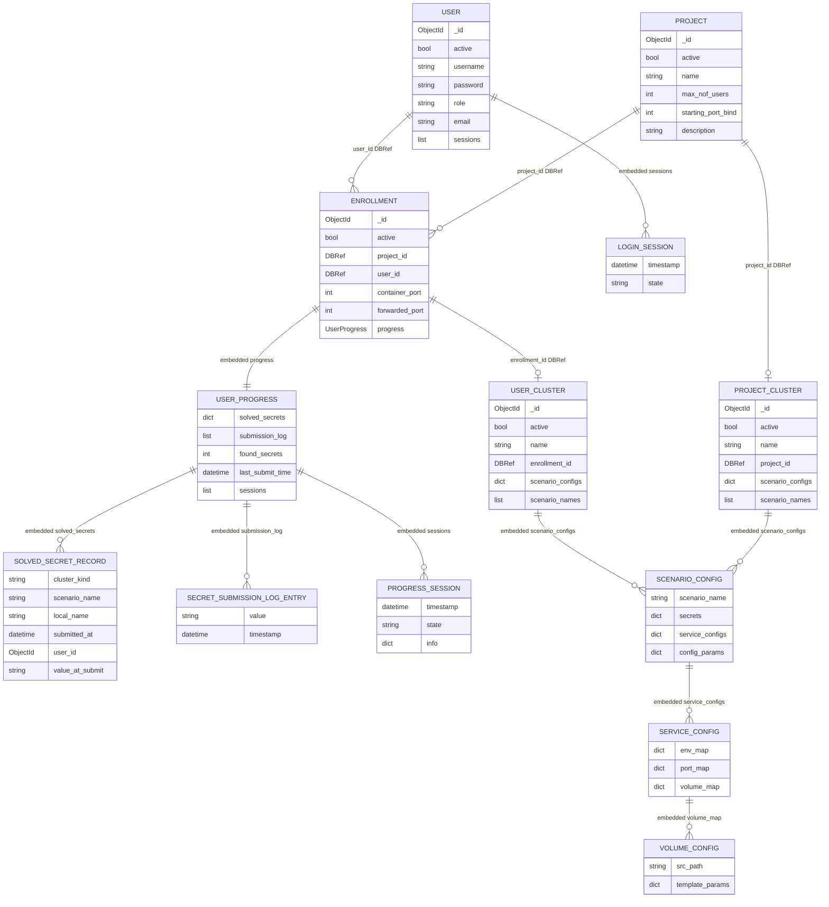
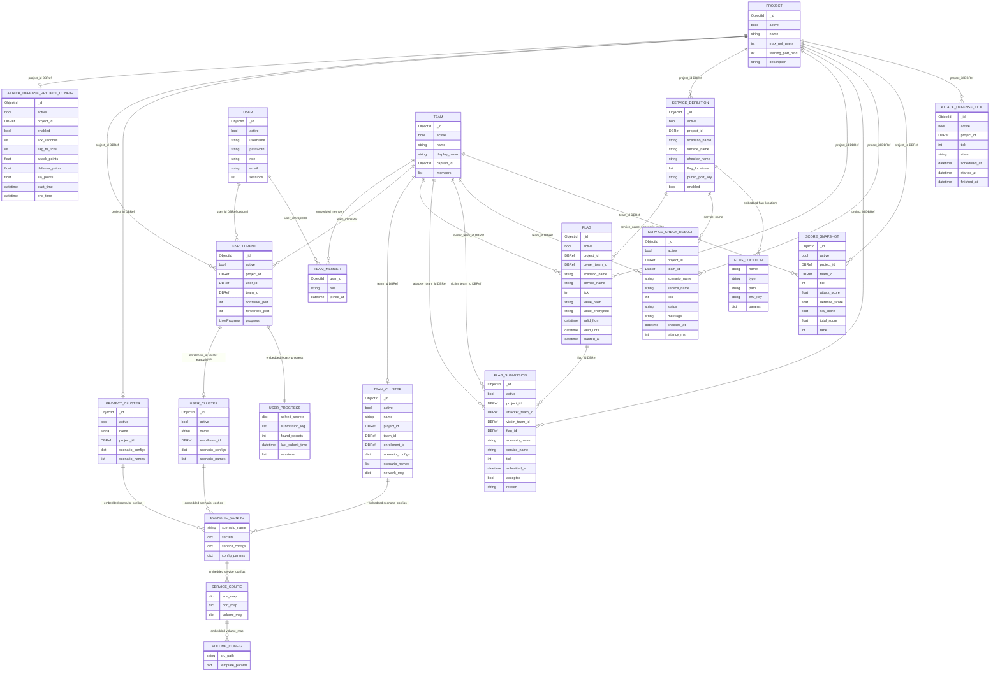

# Databázové schémy

Tento dokument ukazuje dve databázové schémy vo forme Mermaid diagramov:

1. aktuálny stav databázy vo frameworku `fit-ctf`,
2. navrhovaný stav pre podporu Attack & Defense režimu.

Keďže projekt používa MongoDB, schémy nie sú relačné tabuľky v striktnom SQL zmysle.
Diagramy preto rozlišujú medzi samostatnými kolekciami, referenciami cez `DBRef` alebo
`ObjectId` a vnorenými dokumentmi.

## 1. Aktuálna databáza

Aktuálne inicializované Mongo kolekcie sú:

- `project`
- `user`
- `enrollment`
- `project_cluster`
- `user_cluster`

V kóde existuje aj model `Team`, ale dnes nie je inicializovaný v `CTFBase` a nie je
napojený do enrollment/scoring toku. Preto nie je súčasťou hlavnej aktuálnej schémy.

### Krátka interpretácia

`Project` je súťaž/projekt. `User` je účet súťažiaceho alebo admina.
`Enrollment` prepája používateľa s projektom a zároveň v sebe drží celý
`UserProgress`. `ProjectCluster` patrí projektu a slúži na project-level scenáre.
`UserCluster` patrí enrollmentu a slúži na per-user scenáre. Konfigurácie scenárov,
služieb, portov, volume máp a secretov sú vnorené v cluster dokumentoch.

## 2. Navrhovaná databáza pre Attack & Defense

Attack & Defense režim potrebuje ponechať existujúce entity, ale doplniť ich o tímový
model, A&D konfiguráciu, súťažné služby, rotujúce flagy, submit záznamy, výsledky
checkerov a predpočítané skóre.

### Krátka interpretácia

`AttackDefenseProjectConfig` zapína A&D režim pre konkrétny projekt a drží parametre
tiku, TTL flagov a bodovania. `Team` sa stáva prvotriednym objektom a `Enrollment`
sa rozšíri o voliteľné `team_id`, aby jeden projekt mohol podporovať klasický user
režim aj tímový A&D režim. `TeamCluster` je cieľový ekvivalent dnešného
`UserCluster`, ale pomenovaný a naviazaný na tím.

`ServiceDefinition` hovorí, ktoré služby sú v A&D súťažné a akým checkerom sa
kontrolujú. `Flag` reprezentuje rotujúci flag patriaci obeti, službe a tiku.
`FlagSubmission` zaznamenáva útok tímu na cudzí flag. `ServiceCheckResult` ukladá
výsledky checkerov pre obranu a SLA. `ScoreSnapshot` je predpočítaný scoreboard pre
konkrétny tick. `AttackDefenseTick` je voliteľná, ale praktická kolekcia pre
scheduler, audit a opakovateľnosť behov.

## 3. Minimálna MVP verzia

Ak má byť implementácia čo najmenšia, dá sa začať bez samostatného `TeamCluster`.
Vtedy sa tím reprezentuje technickým `User` účtom a používa sa existujúci
`UserCluster`. Pre čistý finálny návrh je však lepšie počítať s `TeamCluster`, lebo
A&D model prirodzene pracuje s tímami, nie s jednotlivými používateľmi.

Minimálne nové kolekcie pre použiteľné A&D jadro:

- `attack_defense_project_config`
- `team`
- `service_definition`
- `flag`
- `flag_submission`
- `service_check_result`
- `score_snapshot`

Odporúčané doplnenia do existujúcich kolekcií:

- `enrollment.team_id`
- `team.display_name`
- `team.members`
- `team.captain_id`

## 4. Presne čo sa zmenilo oproti aktuálnej databáze

### 4.1 Nové kolekcie

Do databázy pribudnú tieto nové kolekcie:

- `attack_defense_project_config`
  - drží A&D nastavenia pre konkrétny projekt,
  - umožňuje zapnúť A&D len pre vybrané projekty,
  - obsahuje dĺžku ticku, TTL flagov, bodové váhy a čas začiatku/konca súťaže.

- `team`
  - mení model súťaženia z individuálneho používateľa na tím,
  - obsahuje názov tímu, zobrazované meno, kapitána a členov tímu,
  - nadväzuje na existujúci, ale dnes neintegrovaný model `Team`.

- `team_cluster`
  - cieľový tímový ekvivalent dnešného `user_cluster`,
  - patrí konkrétnemu tímu a projektu,
  - drží scenáre a služby, ktoré bežia pre daný tím v A&D režime.

- `service_definition`
  - opisuje, ktoré služby sú v A&D súťažné,
  - spája scenár, službu, checker a miesta, kam sa majú vkladať flagy,
  - dopĺňa chýbajúce metadáta, ktoré dnešný `ScenarioConfig` nemá.

- `flag`
  - nahrádza statický secret rotujúcim A&D flagom,
  - každý flag patrí projektu, tímu-obeti, službe a ticku,
  - v DB sa má ukladať hlavne hash, prípadne šifrovaná hodnota, nie plain text.

- `flag_submission`
  - zaznamenáva každý submit ukradnutého flagu,
  - obsahuje útočiaci tím, tím-obeť, flag, službu, tick, čas submitu a výsledok validácie,
  - rieši prípady ako duplicitný submit, vlastný flag, expirovaný flag alebo neznámy flag.

- `service_check_result`
  - ukladá výsledky checkerov,
  - pre každý tím, službu a tick hovorí, či služba bola `up`, `down`, `mumble` alebo nastala chyba checkera,
  - slúži ako podklad pre defense/SLA skóre.

- `score_snapshot`
  - drží predpočítané skóre tímu pre konkrétny tick,
  - obsahuje attack, defense, SLA, total score a rank,
  - zrýchľuje scoreboard, lebo sa nemusí pri každom zobrazení prepočítavať celá história.

- `attack_defense_tick`
  - voliteľná, ale odporúčaná kolekcia pre scheduler,
  - drží stav ticku a časy `scheduled_at`, `started_at`, `finished_at`,
  - pomáha pri audite, opakovaní výpočtov a riešení zlyhaných behov.

### 4.2 Zmenené existujúce kolekcie

`project` ostáva základom súťaže. Nepridávajú sa doň A&D polia priamo, aby klasický
CTF režim ostal spätne kompatibilný. A&D nastavenia sú oddelené v
`attack_defense_project_config`.

`user` ostáva ako účet konkrétneho človeka. V A&D už používateľ nie je hlavná skórovaná
jednotka. Skórovanou jednotkou je tím. Používatelia sú priradení do tímov cez
`team.members`.

`enrollment` sa rozšíri o:

- `team_id`

Význam zmeny:

- v klasickom CTF enrollment stále prepája `user_id` a `project_id`,
- v A&D enrollment prepája hlavne `team_id` a `project_id`,
- `user_id` môže ostať kvôli spätnej kompatibilite alebo MVP variante s technickým
  tímovým účtom.

`user_cluster` ostáva kvôli existujúcemu režimu a kvôli MVP variante A&D. Vo finálnom
A&D návrhu ho pre tímové inštancie nahrádza `team_cluster`.

`project_cluster` ostáva projektový/organizačný klaster. V A&D v ňom môžu bežať
organizačné komponenty ako scheduler, checker runner, flag rotator, submission API
a scoreboard.

`ScenarioConfig` a `ServiceConfig` ostávajú vnorené v cluster dokumentoch. Rozšírenie
sa nerobí priamo v nich, ale cez `service_definition`, pretože A&D potrebuje doménové
metadáta nad službami, napríklad checker, flag locations a public port key.

`UserProgress` ostáva pre klasické statické secrety. A&D skórovanie sa neukladá do
`UserProgress`, ale do nových kolekcií `flag_submission`, `service_check_result` a
`score_snapshot`.

### 4.3 Zmenené vzťahy medzi entitami

Aktuálne:

- `Project -> Enrollment -> User`
- `Enrollment -> UserProgress`
- `Enrollment -> UserCluster`
- `Project -> ProjectCluster`

Po doplnení A&D:

- `Project -> AttackDefenseProjectConfig`
- `Project -> Team -> TeamMember -> User`
- `Project -> Enrollment -> Team`
- `Team -> TeamCluster`
- `Project -> ServiceDefinition`
- `Team -> Flag` ako vlastník/obeť flagu
- `Team -> FlagSubmission` ako útočník aj obeť
- `Flag -> FlagSubmission`
- `Team -> ServiceCheckResult`
- `Team -> ScoreSnapshot`
- `Project -> AttackDefenseTick`

Najväčšia doménová zmena je, že v klasickom CTF je centrom progresu používateľ,
zatiaľ čo v A&D je centrom progresu tím.

### 4.4 Zmena práce s flagmi

Dnes:

- flagy/secrety sú súčasťou `ScenarioConfig.secrets`,
- submit sa porovnáva proti secretom z používateľského alebo projektového klastra,
- vyriešený secret sa uloží do `Enrollment.progress.solved_secrets`,
- submit log sa uloží do `Enrollment.progress.submission_log`.

V A&D:

- flag vzniká pravidelne pre každý tick, tím a službu,
- flag má vlastníka, teda tím-obeť,
- flag má platnosť cez `valid_from` a `valid_until`,
- submit sa neukladá do `UserProgress`, ale do `flag_submission`,
- validácia kontroluje hash flagu, TTL, duplicitu, projekt, službu a to, či tím
  nesubmituje vlastný flag.

### 4.5 Zmena scoringu

Dnes:

- skóre je odvodené od počtu nájdených statických secretov v `UserProgress`,
- leaderboard sa dá vypočítať z enrollmentov a ich progressu.

V A&D:

- attack skóre sa počíta z akceptovaných záznamov v `flag_submission`,
- defense/SLA skóre sa počíta z výsledkov v `service_check_result`,
- celkové skóre sa ukladá do `score_snapshot`,
- scoreboard číta hlavne `score_snapshot`, nie surové submit/check dáta pri každom
  refreshi.

### 4.6 Zmena infraštruktúry klastrov

Dnes:

- `ProjectCluster` je jeden zdieľaný klaster projektu,
- `UserCluster` je privátny klaster jedného enrollmentu.

V A&D:

- `ProjectCluster` ostáva pre organizačné komponenty,
- `TeamCluster` je cieľový privátny/battle klaster jedného tímu,
- pre MVP sa dá dočasne použiť `UserCluster` s technickým tímovým používateľom,
- finálny návrh však používa `TeamCluster`, aby názvy, siete, scoring a ownership
  zodpovedali tímovému modelu.

### 4.7 Spätná kompatibilita

Návrh je spravený tak, aby nerozbil existujúci klasický CTF režim:

- `project` sa nemení na A&D-only entitu,
- `user` ostáva platný,
- `enrollment.user_id` ostáva zachované,
- `UserProgress` ostáva zachovaný pre klasické secrety,
- `user_cluster` ostáva zachovaný,
- A&D špecifické dáta sú vo vlastných kolekciách,
- A&D sa zapína explicitne cez `attack_defense_project_config.enabled`.

### 4.8 Stručný diff v jednej tabuľke

| Oblasť | Teraz | Po A&D návrhu |
| --- | --- | --- |
| Súťažná jednotka | `User` cez `Enrollment` | `Team` cez `Enrollment.team_id` |
| Projekt | `project` | `project` + `attack_defense_project_config` |
| Klaster súťažiaceho | `user_cluster` | `team_cluster`, MVP môže použiť `user_cluster` |
| Flag | statický secret v `ScenarioConfig.secrets` | rotujúci dokument v `flag` |
| Submit | `UserProgress.submission_log` | `flag_submission` |
| Vyriešené úlohy | `UserProgress.solved_secrets` | akceptované `flag_submission` |
| Dostupnosť služieb | neukladá sa ako doménová entita | `service_check_result` |
| Scoreboard | počíta sa z progressu enrollmentov | číta `score_snapshot` |
| Tick/kolo | neexistuje | `attack_defense_tick` |
| Metadáta služby | len `ServiceConfig` pre compose | `service_definition` pre A&D checker/flag logic |
