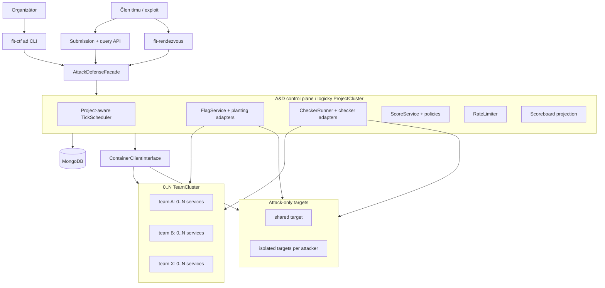
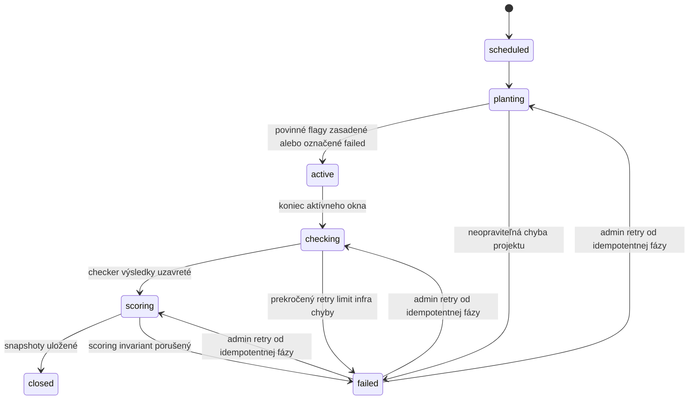
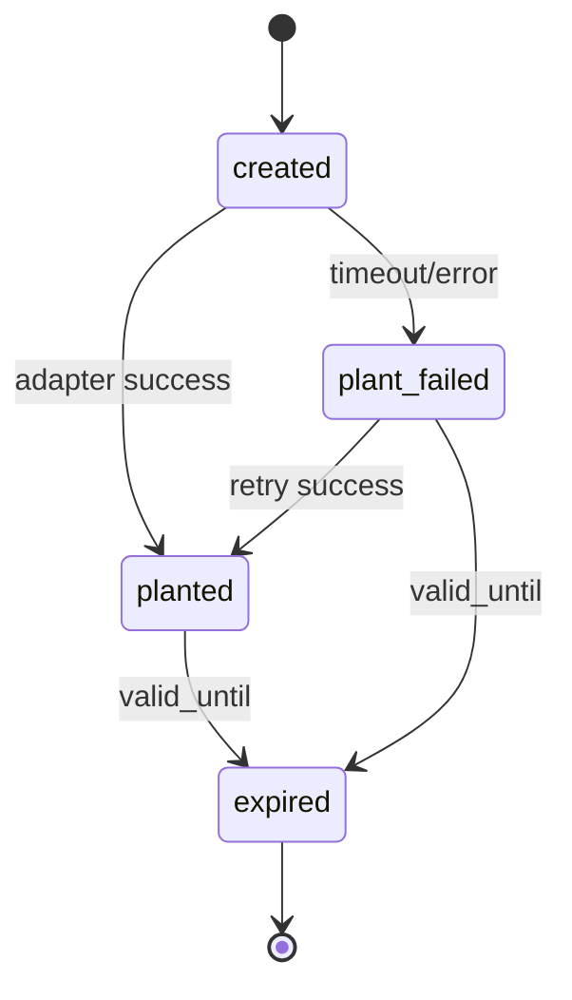

# Kompletný návrh implementácie Attack–Defense rozšírenia

## 0. Účel a stav dokumentu

Tento dokument je implementačný návrh určený na manuálny audit pred začiatkom
programovania. Nadväzuje na aktuálnu architektúru `fit-ctf` opísanú v ostatných
súboroch v `devData` a spresňuje ju na úroveň doménových objektov, kolekcií, rozhraní,
životných cyklov, API, CLI, bezpečnosti, testov a poradia implementácie.

Návrh podporuje tri súťažné režimy:

- **Attack & Defense** – tímy prevádzkujú svoje služby, útočia na ostatné tímy a
  získavajú body za útok aj obranu.
- **Attack-only** – tímy útočia na organizátorom spravované cieľové služby; vlastnú
  obranu nemajú a skóruje sa iba útok.
- **Defense-only** – tímy prevádzkujú a opravujú svoje služby, ale navzájom na seba
  neútočia; skóruje sa funkčnosť, integrita flagov a SLA.

Prvá implementačná ukážka môže mať iba dva tímy a jednu službu. Žiadna doménová,
databázová ani runtime časť však nesmie obsahovať predpoklad `team_a/team_b`, pevný
počet dva alebo jednu globálnu práve bežiacu súťaž. Všetky operácie musia byť
projektovo ohraničené a pracovať s ľubovoľným počtom tímov, služieb a súčasne
bežiacich CTF projektov.

Tento dokument zámerne nenavrhuje prepísanie klasického Jeopardy režimu. Existujúce
projekty, enrollmenty, `UserProgress`, statické secrety, `UserCluster` a klasický
leaderboard zostávajú funkčné.

---

## 1. Záväzné návrhové rozhodnutia

### 1.1 A&D je rozšírenie projektu, nie nový druh aplikácie

`Project` zostáva koreňom súťaže. Projekt môže mať voliteľnú A&D konfiguráciu. Ak ju
nemá, správa sa presne ako dnes. A&D logika preto nesmie meniť význam existujúcich
statických secretov ani `UserProgress`.

### 1.2 Tím je prvotriedna entita od začiatku

Existujúci `src/fit_ctf/models/core/team.py` sa použije ako východisko, ale rozšíri sa
a reálne sa inicializuje v `CTFBase`. Technický `User` účet vydávajúci sa za tím sa
nepoužije ako cieľová architektúra. Ušetril by niekoľko tried v prototype, ale neskôr
by skomplikoval vlastníctvo služieb, oprávnenia, audit, tokeny a scoring.

Používateľ je človek. Tím je súťažná identita. Účet môže byť členom tímu a tím môže
byť zapísaný do projektu.

### 1.3 Tímový enrollment je samostatný objekt

Existujúci `Enrollment` naďalej spája `User` a `Project`. Nebude sa meniť na nejasnú
union entitu s pravidlom „buď `user_id`, alebo `team_id`“. Pribudne samostatný
`TeamEnrollment`, ktorý spája `Team` a `Project` a drží projektovo špecifické údaje:
stav účasti, team tokeny, pridelené porty a runtime referencie.

Tým sa zachová spätná kompatibilita a databáza nebude umožňovať neplatné enrollmenty
bez používateľa aj bez tímu alebo s oboma súčasne.

### 1.4 Jeden logický `TeamCluster` na tím a projekt

Každý aktívny `TeamEnrollment` má najviac jeden `TeamCluster`. Klaster môže obsahovať
ľubovoľný počet scenárov a každý scenár ľubovoľný počet kontajnerových služieb.

„Server“ nebude samostatnou základnou doménovou jednotkou. V prvom nasadení je služba
kontajner v logickom tímovom klastri. Neskoršie rozloženie na viac fyzických hostov sa
má riešiť cez deployment backend/placement, nie zmenou tímového a scoring modelu.

### 1.5 Režimy sú politiky schopností, nie tri kópie systému

Konfigurácia obsahuje explicitný `mode`, z ktorého sa odvodia schopnosti:

| Režim | Team-owned služby | Organizer targets | Flag submit | Attack score | Defense/SLA score |
| --- | --- | --- | --- | --- | --- |
| `attack_defense` | áno | voliteľne | áno | áno | áno |
| `attack_only` | nie, iba attack workspace | áno | áno | áno | nie |
| `defense_only` | áno | nie | nie | nie | áno |

Manažéry flagov, tickov, checkerov a snapshotov ostávajú spoločné. Rozdielne pravidlá
sa implementujú cez `CompetitionModePolicy` a `ScoringPolicy`, nie cez rozsiahle
`if mode == ...` roztrúsené po kóde.

### 1.6 Tick a výsledky sú per-project

Neexistuje globálny `current_tick`. Každý projekt má vlastný začiatok, dĺžku ticku,
stav a scheduler lease. Dva projekty môžu bežať súčasne s rôznymi dĺžkami tickov.

### 1.7 Udalosti sú zdroj pravdy, snapshot je projekcia

Flagy, prijaté submity a checker výsledky sú auditovateľné udalosti. Score snapshot je
deterministicky prepočítateľná projekcia. Ak sa scoring policy opraví, snapshoty sa
môžu z udalostí znovu vytvoriť.

### 1.8 Doménová logika nebude závislá od umiestnenia procesu

Scheduler, checker runner, planter, API a score manager logicky patria ku control
plane A&D projektu. Môžu počas vývoja bežať ako host procesy a neskôr ako kontajnery
v `ProjectCluster`. Ich doménové služby nesmú priamo predpokladať konkrétny spôsob
nasadenia.

---

## 2. Význam troch režimov

### 2.1 Plný Attack & Defense

Každý tím dostane rovnakú sadu súťažných služieb vo vlastnom `TeamCluster`. Členovia
tímu môžu svoje služby meniť a opravovať. Služby sú dostupné na battle/shared sieti.
Na začiatku každého ticku systém vytvorí pre každú dvojicu tím + služba nový flag a
vloží ho do služby vlastníka.

Iné tímy flag získajú exploitom a submitnú ho. Checker nezávisle overuje dostupnosť,
funkčnosť a schopnosť služby uchovať alebo vrátiť vložený flag. Skóre má attack,
defense a SLA časť.

Minimálny počet aktívnych tímov pre zmysluplný štart je dva.

### 2.2 Attack-only

Čistý attack režim nesmie dať cieľové služby pod kontrolu súperov, ktorí nemajú žiadnu
obrannú motiváciu. Inak môže tím svoju službu vypnúť a znemožniť ostatným skórovať.

Preto cieľové služby spravuje organizátor:

- `shared` topológia – všetky tímy útočia na rovnaké cieľové inštancie;
- `isolated_per_team` topológia – každý tím dostane vlastnú kópiu cieľa, ktorú však
  nespravuje a nepatchuje; eliminuje zdieľanie flagov medzi tímami.

Tímový klaster môže obsahovať login node/attack workspace, nástroje a tímové dáta,
ale nie skórovanú obrannú službu. Ciele bežia v projektovej alebo samostatnej target
runtime vrstve a sú opísané rovnakými service definitions a service instances ako
ostatné režimy.

Flag patrí cieľovej inštancii, nie tímu-obeti. Každý tím môže daný flag odovzdať raz.
Skóruje sa iba attack komponent. Checkery sa používajú na kontrolu férovosti cieľov,
ale ich výsledky nepridávajú body tímom.

Režim funguje už s jedným tímom. Pre prvú verziu sa odporúča
`isolated_per_team`, pretože je odolnejší proti zdieľaniu získaných flagov.

### 2.3 Defense-only

Každý tím spravuje rovnakú sadu služieb vo vlastnom `TeamCluster`. Systém rotuje
canary flagy a checker vykonáva funkčné aj flagové kontroly. Submission API pre útoky
je pre projekt vypnuté.

Skóruje sa:

- úspešné vloženie a následné získanie/overenie flagu,
- funkčnosť služby,
- dlhodobé SLA,
- voliteľne rýchlosť obnovenia po výpadku.

Režim funguje už s jedným tímom a je vhodný na tréning patchovania, hardeningu a
prevádzky.

### 2.4 Prechod režimu

Zmenu `mode` po štarte súťaže treba zakázať. Mení význam cieľov, submissionov aj
scoringu. Organizátor môže súťaž zastaviť a vytvoriť novú konfiguráciu/revíziu, ale
historické tick dokumenty musia naďalej niesť `mode` a `scoring_policy_version`, ktoré
platili pri ich vzniku.

---

## 3. Cieľová architektúra



### 3.1 Využité existujúce časti

- `Project` zostáva koreňom a namespace súťaže.
- `User` zostáva autentifikovaným človekom.
- `ScenarioConfig`, `ServiceConfig` a `VolumeConfig` zostávajú deployment
  konfiguráciou.
- `ScenarioCompiler` zostáva rendererom compose a volume šablón.
- `BaseCluster` a `ClusterManagerMixin` sa použijú aj pre `TeamCluster`.
- `ProjectCluster` zostáva priestorom spoločnej/organizačnej infraštruktúry.
- `ContainerClientInterface` zostáva hranicou runtime operácií.
- `EntityRepository` sa rozšíri o projektovo ohraničené team/A&D lookupy.
- CLI a Rendezvous budú klientmi rovnakej aplikačnej vrstvy.

### 3.2 Nové vrstvy

```text
src/fit_ctf/models/ad/
  config.py                 # ADProjectConfig, config manager
  team_enrollment.py        # účasť tímu v projekte + tokeny
  service_definition.py     # deklarácia skórovanej služby
  service_instance.py       # konkrétne nasadený cieľ
  tick.py                   # persistentný tick a lease
  flag.py                   # flag metadata a bezpečný lookup
  submission.py             # prijaté A&D submity
  check_result.py           # checker výsledky
  score_snapshot.py         # tick/cumulative projekcia
  metrics.py                # agregované anti-spam/prevádzkové metriky

src/fit_ctf/models/infra/
  team_cluster.py           # TeamCluster + TeamClusterManager

src/fit_ctf/ad/
  facade.py                 # use-case API pre CLI/TUI/HTTP
  modes.py                  # CompetitionModePolicy
  scheduler.py              # multi-project tick orchestrácia
  flag_service.py           # generate, digest, validity, planting
  checker_service.py        # plánovanie a paralelné checky
  submission_service.py     # autentifikácia a atómová validácia
  scoring_service.py        # policy + snapshoty
  scoreboard_service.py     # read model
  ports.py                  # Protocol/ABC hranice
  adapters/
    planting_file.py
    planting_http.py
    planting_exec.py
    checker_container.py
    checker_process.py
    rate_limit_memory.py
    rate_limit_redis.py      # voliteľné neskôr

src/fit_ctf_api/            # samostatný HTTP entry point
  __main__.py
  routes/
  auth.py
  schemas.py

src/fit_ctf_cli/cli/ad/     # operátorské a diagnostické príkazy
```

Názvy balíkov sa môžu pri implementácii upraviť, ale oddelenie doménových modelov,
orchestrace, portov a runtime adaptérov sa má zachovať.

---

## 4. Doménový model

### 4.1 `Team`

Rozšírenie existujúceho modelu:

```python
class Team(Base):
    name: str                    # stabilný slug, globálne unikátny
    display_name: str
    user_ids: list[ObjectId]
    captain_id: ObjectId | None
    created_at: datetime
```

Pravidlá:

- používateľ môže byť členom viacerých tímov všeobecne;
- v jednom projekte môže byť používateľ najviac v jednom aktívnom zapísanom tíme,
  ak konfigurácia projektu výslovne nepovolí opak;
- odstránenie tímu s historickou účasťou je soft delete (`active=False`);
- zmena `name` po vytvorení runtime infraštruktúry je zakázaná alebo riešená explicitnou
  migráciou; `display_name` sa môže meniť.

### 4.2 `TeamEnrollment`

```python
class TeamEnrollment(Base):
    project_id: DBRef
    team_id: DBRef
    state: Literal["pending", "active", "suspended", "finished"]
    enrolled_at: datetime
    activated_at: datetime | None
    member_ids_snapshot: list[ObjectId]
    token_version: int
    token_hash: str
    token_prefix: str
    port_range_start: int | None
    port_range_size: int
```

`member_ids_snapshot` zachová súťažný roster pri štarte. Aktuálne oprávnenia môže
organizátor synchronizovať explicitným príkazom; obyčajná zmena globálneho tímu nemá
potichu meniť rozbehnutú súťaž.

Team API token sa zobrazí iba pri vytvorení/rotácii. V databáze bude iba Argon2 hash
alebo HMAC digest vhodný na rýchly lookup cez bezpečný prefix + overenie. Token má byť
projektovo viazaný a musí podporovať revokáciu cez `token_version`.

### 4.3 `TeamCluster`

```python
class TeamCluster(BaseCluster):
    team_enrollment_id: DBRef
```

`TeamClusterManager` použije `ClusterManagerMixin` a implementuje rovnaké template
hooky ako `UserClusterManager`:

- cieľ: `projects/<project>/teams/<team>/<scenario>/`;
- názov: `<project>_<team>`;
- siete: `<project>_shared_net`, `<project>_<team>_private_net`;
- template extras: `project_name`, `team_name`, `team_enrollment_id`, pridelené porty;
- project cluster sa pred štartom tímového klastra zabezpečí rovnako ako dnes pri
  user clusteri.

Jeden klaster obsahuje viac scenárov a viac služieb. Počet tímov sa nikde nezakóduje;
manager vždy načíta aktívne `TeamEnrollment` dokumenty projektu.

### 4.4 `ADProjectConfig`

```python
class ADProjectConfig(Base):
    project_id: DBRef
    mode: Literal["attack_defense", "attack_only", "defense_only"]
    state: Literal["draft", "ready", "running", "paused", "finished", "failed"]

    tick_seconds: int
    flag_ttl_ticks: int
    checker_runs_per_tick: int
    checker_concurrency: int
    planting_concurrency: int

    start_time: datetime | None
    end_time: datetime | None
    timezone: str

    attack_target_topology: Literal["shared", "isolated_per_team"] | None
    scoring_policy: str
    scoring_policy_version: int
    scoring_params: dict[str, Any]

    submit_rate_per_second: float
    submit_burst: int
    submit_batch_size: int
    rejected_audit_policy: Literal["all", "sampled", "aggregated"]

    revision: int
    created_at: datetime
    updated_at: datetime
```

Validácia konfigurácie:

- `tick_seconds >= 10` pre produkčný režim;
- `flag_ttl_ticks >= 1`;
- `checker_runs_per_tick >= 1` pri defense schopnosti;
- attack-only vyžaduje `attack_target_topology`;
- defense-only nesmie mať zapnuté submission endpointy;
- start je povolený iba po úspešnom `preflight`;
- po štarte sú nemenné `mode`, tick dĺžka, topológia a zásadné scoring parametre;
  zmeny sa robia ako nová revízia platná od budúceho ticku a auditujú sa.

### 4.5 `ADServiceDefinition`

Definícia opisuje typ služby, nie konkrétnu tímovú inštanciu.

```python
class ADServiceDefinition(Base):
    project_id: DBRef
    key: str                         # stabilný identifikátor v projekte
    display_name: str
    scenario_name: str
    compose_service_name: str
    enabled: bool

    supported_modes: set[str]
    owner_scope: Literal["team", "organizer_target"]
    public_endpoint: EndpointTemplate
    checker: CheckerSpec
    flag_adapter: FlagAdapterSpec
    scoring_weight: float
    revision: int
```

Príklad metadát scenára v `ad.yaml`:

```yaml
version: 1
services:
  vulnerable_web:
    compose_service: web
    supported_modes: [attack_defense, attack_only, defense_only]
    endpoint:
      scheme: http
      network: shared
      port_key: http
    checker:
      adapter: container
      module: checker_vulnerable_web
      timeout_seconds: 10
      actions: [check, put, get]
    flag:
      adapter: file
      directory_mount: flags
      relative_path: current.flag
    scoring_weight: 1.0
```

`ad.yaml` je vlastnosť šablóny scenára. Projekt pri pridaní scenára vytvorí svoju
revidovanú `ADServiceDefinition`, takže zmena globálnej šablóny spätne nezmení
rozbehnutú súťaž.

### 4.6 `ADServiceInstance`

Táto entita zjednocuje tímové služby a attack-only ciele.

```python
class ADServiceInstance(Base):
    project_id: DBRef
    service_definition_id: DBRef
    instance_key: str
    scope: Literal[
        "team_owned",
        "organizer_shared",
        "organizer_isolated",
    ]

    owner_team_enrollment_id: DBRef | None
    assigned_attacker_team_enrollment_id: DBRef | None
    cluster_kind: Literal["team", "project", "target"]
    cluster_id: DBRef
    runtime_service_name: str
    endpoint: ResolvedEndpoint
    deployment_revision: int
```

Mapovanie režimov:

- full A&D a defense-only: `team_owned`, `owner_team_enrollment_id` je povinné;
- attack-only/shared: `organizer_shared`, bez ownera a bez assigned attackera;
- attack-only/isolated: `organizer_isolated`, s povinným assigned attackerom.

Vďaka tejto vrstve checker ani flag manager nemusia vedieť, v akom druhu klastra
služba fyzicky beží.

### 4.7 `ADTick`

```python
class ADTick(Base):
    project_id: DBRef
    number: int
    mode: str
    state: Literal[
        "scheduled", "planting", "active", "checking",
        "scoring", "closed", "failed"
    ]
    scheduled_at: datetime
    started_at: datetime | None
    active_at: datetime | None
    closed_at: datetime | None

    config_revision: int
    scoring_policy_version: int
    expected_instance_count: int
    planted_instance_count: int
    checked_instance_count: int

    lease_owner: str | None
    lease_until: datetime | None
    attempt: int
    error_summary: str | None
```

Unikátna dvojica je `(project_id, number)`. Stavové prechody sú podmienené a
atómové. Tick sa nevytvorí dvakrát ani pri dvoch scheduler procesoch.

### 4.8 `ADFlag`

```python
class ADFlag(Base):
    project_id: DBRef
    tick_id: DBRef
    tick_number: int
    service_instance_id: DBRef
    service_definition_id: DBRef

    owner_team_enrollment_id: DBRef | None
    assigned_attacker_team_enrollment_id: DBRef | None
    slot: int

    lookup_digest: str
    encrypted_value: str | None
    key_version: int

    state: Literal["created", "planted", "plant_failed", "expired"]
    valid_from: datetime
    valid_until: datetime
    planted_at: datetime | None
    planting_attempts: int
    last_error: str | None
```

Flag formát má obsahovať projektovo nerozpoznateľnú náhodnú časť, napríklad
`FITCTF{<base64url 192-bit random>}`. Hodnota sa nikdy neloguje.

Na lookup sa použije HMAC-SHA-256 s aplikačným pepperom a konštantné porovnanie.
Šifrovaná hodnota je potrebná iba pre adaptéry/checkery, ktoré musia flag neskôr znovu
poznať. Šifrovací kľúč je mimo MongoDB a má `key_version`. Pri adaptéri, ktorý vie
overovať cez digest, sa plaintext po zasadení nemusí uchovávať.

### 4.9 `ADFlagSubmission`

```python
class ADFlagSubmission(Base):
    project_id: DBRef
    attacker_team_enrollment_id: DBRef
    flag_id: DBRef
    service_instance_id: DBRef
    victim_team_enrollment_id: DBRef | None
    tick_number: int
    submitted_at: datetime
    accepted: bool
    reason: str
    source: Literal["api", "cli", "tui"]
    request_id: str
```

Primárny scoring záznam je iba prvý akceptovaný submit dvojice
`(project, attacker_team_enrollment, flag)`. Duplicita sa musí vyriešiť unikátnym
indexom/atómovou operáciou, nie sekvenciou „najprv find, potom insert“.

Nie každý chybný náhodný flag sa musí ukladať ako samostatný dokument. Pozri
anti-spam návrh.

### 4.10 `ADServiceCheckResult`

```python
class ADServiceCheckResult(Base):
    project_id: DBRef
    tick_id: DBRef
    tick_number: int
    service_instance_id: DBRef
    service_definition_id: DBRef
    owner_team_enrollment_id: DBRef | None
    run_number: int

    status: Literal[
        "up", "down", "mumble", "corrupt",
        "plant_failed", "checker_error", "timeout"
    ]
    functional_ok: bool
    flag_ok: bool | None
    latency_ms: int | None
    message_code: str
    message_detail: str
    checker_revision: int
    checked_at: datetime
```

`checker_error` a chyba organizátorskej infraštruktúry nesmú automaticky poškodiť
skóre tímu. Scoring policy rozhodne, či tick pre danú službu ignoruje alebo zopakuje.

### 4.11 `ADScoreSnapshot`

```python
class ADScoreSnapshot(Base):
    project_id: DBRef
    tick_number: int
    team_enrollment_id: DBRef
    mode: str
    policy_name: str
    policy_version: int

    tick_attack_delta: Decimal
    tick_defense_delta: Decimal
    tick_sla_delta: Decimal
    tick_penalty_delta: Decimal

    attack_total: Decimal
    defense_total: Decimal
    sla_total: Decimal
    penalty_total: Decimal
    total: Decimal
    rank: int

    input_digest: str
    computed_at: datetime
```

Na body sa nepoužije binárny `float`, ale `Decimal` alebo celočíselné milli-points.
`input_digest` identifikuje vstupné udalosti a verziu policy, aby bol recompute
auditovateľný.

### 4.12 Agregované submission metriky

```python
class ADSubmissionMetricBucket(Base):
    project_id: DBRef
    team_enrollment_id: DBRef | None
    minute: datetime
    accepted: int
    duplicate: int
    rejected_unknown: int
    rejected_expired: int
    rejected_self: int
    rate_limited: int
```

Bucket zabraňuje tomu, aby spam náhodnými reťazcami vytvoril milióny auditných
dokumentov.

---

## 5. Databázové kolekcie a indexy

Nové kolekcie:

```text
team
team_enrollment
team_cluster
ad_project_config
ad_service_definition
ad_service_instance
ad_tick
ad_flag
ad_flag_submission
ad_service_check_result
ad_score_snapshot
ad_submission_metric_bucket
```

Odporúčané indexy:

```text
team:
  UNIQUE (name)

team_enrollment:
  UNIQUE (project_id.$id, team_id.$id)
  INDEX  (project_id.$id, state)
  INDEX  (team_id.$id, state)

team_cluster:
  UNIQUE (team_enrollment_id.$id)
  UNIQUE (name)

ad_project_config:
  UNIQUE (project_id.$id)
  INDEX  (state, start_time, end_time)

ad_service_definition:
  UNIQUE (project_id.$id, key, revision)
  INDEX  (project_id.$id, enabled)

ad_service_instance:
  UNIQUE (project_id.$id, instance_key, deployment_revision)
  INDEX  (project_id.$id, owner_team_enrollment_id.$id)
  INDEX  (project_id.$id, assigned_attacker_team_enrollment_id.$id)

ad_tick:
  UNIQUE (project_id.$id, number)
  INDEX  (project_id.$id, state)
  INDEX  (state, lease_until)

ad_flag:
  UNIQUE (project_id.$id, service_instance_id.$id, tick_number, slot)
  UNIQUE (project_id.$id, lookup_digest)
  INDEX  (project_id.$id, valid_until)
  INDEX  (project_id.$id, tick_number, state)

ad_flag_submission:
  UNIQUE PARTIAL (project_id.$id, attacker_team_enrollment_id.$id, flag_id.$id)
                 WHERE accepted = true
  INDEX  (project_id.$id, tick_number, accepted)
  INDEX  (project_id.$id, attacker_team_enrollment_id.$id, submitted_at)
  INDEX  (project_id.$id, victim_team_enrollment_id.$id, submitted_at)

ad_service_check_result:
  UNIQUE (project_id.$id, service_instance_id.$id, tick_number, run_number)
  INDEX  (project_id.$id, owner_team_enrollment_id.$id, tick_number)

ad_score_snapshot:
  UNIQUE (project_id.$id, team_enrollment_id.$id, tick_number, policy_version)
  INDEX  (project_id.$id, tick_number, rank)

ad_submission_metric_bucket:
  UNIQUE (project_id.$id, team_enrollment_id.$id, minute)
  TTL alebo retenčný index podľa politiky projektu
```

Všetky často používané dotazy začínajú `project_id`. To je zásadné pre viac súčasne
bežiacich CTF a zabraňuje omylom medzi projektmi.

Pri implementácii treba overiť, či existujúca serializácia `DBRef` vytvára indexy na
`project_id.$id` spoľahlivo. Ak bude Mongo dotazovanie cez DBRef komplikované, nové A&D
kolekcie môžu konzistentne používať priamo `ObjectId` polia. Nemajú miešať oba štýly
v rámci jednej A&D domény.

---

## 6. Runtime a sieťový model

### 6.1 Siete

Pre každý projekt:

- `<project>_shared_net` – battle sieť a verejné cieľové endpointy;
- `<project>_operational_net` – checker, planter, submission API a interné control
  komponenty;
- `<project>_<team>_private_net` – privátne tímové služby a login node;
- voliteľne `<project>_target_<id>_private_net` pre izolované attack-only ciele.

Pravidlá:

- MongoDB nesmie byť pripojená do battle siete;
- súťažný kontajner nesmie dostať Docker/Podman socket;
- team cluster nesmie byť v operational sieti ako celok;
- checker/planter dostanú iba minimálny smerový prístup k cieľovým endpointom;
- submission API je dostupné tímom, ale databáza iba API/control plane;
- názvy sietí, compose projektov a kontajnerov obsahujú projektový namespace.

### 6.2 Viac služieb a viac fyzických serverov

Prvá verzia:

```text
TeamCluster
  scenario A
    service web
    service database
  scenario B
    service vulnerable-api
```

Nie je potrebné vytvárať doménový „server“ pre každý kontajner. Ak sa neskôr bude
nasadzovať na viac hostov, pridá sa `RuntimeTarget`/`Placement`:

```python
class RuntimeTarget:
    name: str
    backend: Literal["docker", "podman", "remote_docker", "kubernetes"]
    labels: dict[str, str]
    capacity: dict[str, int]
```

`ADServiceInstance` potom dostane `runtime_target_id`. Tick, flag, checker, submission
a scoring model sa tým nemenia.

### 6.3 Rozšírenie container klienta

Pre dynamické A&D operácie treba pridať abstrakcie, nie volať `docker` priamo zo
service vrstvy:

```python
class ContainerClientInterface:
    async def exec_service(...): ...
    async def inspect_service(...): ...
    async def copy_to_service(...): ...
    async def ensure_network(...): ...
```

File a HTTP planting ich nemusia používať. Exec adapter áno. Výsledok musí obsahovať
exit code, čas, obmedzený stdout/stderr a timeout. Flag sa musí pred logovaním
redigovať.

---

## 7. Tick scheduler a konzistencia

### 7.1 Výpočet čísla ticku

Po štarte:

```text
tick_number = floor((now_utc - start_time_utc) / tick_seconds)
```

Číslo podľa času umožní scheduleru po reštarte zistiť, ktoré tick dokumenty chýbajú.
Skutočný stav sa však číta z `ad_tick`, nie iba z hodín.

### 7.2 Stavový automat



### 7.3 Odporúčaný priebeh

1. Scheduler získa projektový lease cez atómový `findOneAndUpdate`.
2. Vytvorí `ADTick` s unikátnym `(project_id, number)`.
3. Zoberie snapshot aktívnych service instances a config revision.
4. Vytvorí flagy idempotentným bulk upsertom.
5. Planter s ohraničenou paralelizáciou vloží flagy.
6. Tick prejde do `active`; submission API prijíma flagy podľa ich vlastných okien.
7. Checker sa spustí `checker_runs_per_tick`-krát v deterministických offsetoch.
8. Na hranici ticku sa uzavrú vstupy, scoring vytvorí snapshoty.
9. Tick prejde do `closed` a publikuje sa udalosť o novom scoreboarde.

### 7.4 Paralelizácia pre N tímov

Práca je kartézsky súčin aktívnych service instances, nie ručne napísaných tímov:

```python
instances = service_instance_manager.list_active(project_id)
await bounded_map(config.planting_concurrency, plant_one, instances)
await bounded_map(config.checker_concurrency, check_one, instances)
```

Ohraničená fronta zabráni spusteniu stoviek checker kontajnerov naraz. Zlyhanie jednej
inštancie nezastaví kontroly ostatných tímov a projektov.

### 7.5 Viac súčasných projektov

Jeden scheduler proces môže pollovať všetky `running` konfigurácie a vytvárať
projektovo izolované async úlohy. Alternatívne môže byť worker per projekt. Lease v DB
zaručuje, že obe deployment stratégie používajú rovnakú logiku a nevykonajú tick
dvakrát.

Pomalý checker projektu A nesmie blokovať projekt B. Limity musia existovať per projekt
aj globálne.

### 7.6 Reštart a idempotencia

- generovanie flagu používa unikátny slot a upsert;
- planting eviduje pokusy a bezpečne sa opakuje;
- checker výsledok má unikátny `run_number`;
- accepted submission má unikátny index;
- snapshot sa pre rovnaký input/policy nahradí alebo upsertne;
- lease má timeout a heartbeat;
- admin príkaz `tick retry` pokračuje od poslednej neuzavretej fázy.

---

## 8. Flag lifecycle a planting

### 8.1 Lifecycle



Submission nemení stav flagu, pretože jeden flag môže v plnom A&D akceptovane
submitnúť viac rôznych útočiacich tímov. Duplicita sa sleduje na submission entite.

### 8.2 `FlagPlantingAdapter`

```python
class FlagPlantingAdapter(Protocol):
    async def plant(
        self,
        instance: ADServiceInstance,
        definition: ADServiceDefinition,
        flag: SecretValue,
        context: TickContext,
    ) -> PlantResult: ...
```

Adaptér sa vyberá z `ADServiceDefinition`, nie podľa hardcoded názvu služby.

### 8.3 File adapter – prvá implementácia

Odporúčaný kontrakt je bind mount adresára, nie samostatného súboru:

```text
host: projects/<project>/teams/<team>/<scenario>/runtime/flags/
container: /run/fit-ctf/flags/
```

Planter vytvorí dočasný súbor v rovnakom adresári, nastaví práva, zavolá `fsync` a
atomicky ho premenuje na `current.flag`. Pri mountovaní jednotlivého súboru môže rename
zmeniť inode, ktorý kontajner stále nevidí; mount adresára tomuto problému predchádza.

Služba musí dokumentovať, či flag číta pri každom requeste alebo vyžaduje reload.
Voliteľný reload hook patrí do adapter configu.

### 8.4 HTTP adapter

Interný endpoint je dostupný iba z operational siete. Request obsahuje tick, flag a
idempotency key. Odpoveď musí potvrdiť uloženie bez vrátenia flagu do logov.

Požiadavky:

- mTLS alebo per-instance interný credential;
- timeout a retry s rovnakým idempotency key;
- endpoint nesmie byť routovaný do battle siete;
- checker `get` endpoint je oddelený od planting endpointu.

### 8.5 Exec adapter

Volá deklarovaný príkaz cez rozšírený `ContainerClientInterface`. Flag sa odovzdá cez
stdin alebo dočasný file descriptor, nie v argv, aby nebol viditeľný v process liste.
Príkaz má timeout, obmedzený výstup a redakciu.

### 8.6 Retencia flagov

- aktívne a nedávno expirované flagy zostávajú online pre validáciu/audit;
- po retenčnom období sa odstráni `encrypted_value`, metadata a digest môžu zostať;
- TTL index nesmie odstrániť flag skôr než sú uzavreté tick snapshoty a auditné okno;
- retenčná politika je per projekt.

---

## 9. Checker kontrakt

### 9.1 Akcie

Checker plugin má jednotný kontrakt:

- `check` – základná funkčnosť služby;
- `put` – voliteľné vloženie testovacej hodnoty, ak planting robí checker;
- `get` – získanie/overenie hodnoty vloženej pre tick;
- voliteľne `cleanup` – odstránenie starého testovacieho stavu.

Pre MVP môže file planter robiť `put` a checker iba `check + get`.

### 9.2 Vstup

Checker dostane JSON cez stdin alebo mounted request file:

```json
{
  "protocol_version": 1,
  "project_id": "...",
  "tick": 12,
  "run_number": 0,
  "service_key": "vulnerable_web",
  "instance_key": "team-red/vulnerable_web",
  "endpoint": {
    "scheme": "http",
    "host": "demo_red_web",
    "port": 8080
  },
  "actions": ["check", "get"],
  "deadline": "2026-08-31T18:00:10Z",
  "flag_ref": "opaque-reference"
}
```

Plain flag sa poskytne iba ak ho checker nevyhnutne potrebuje a bezpečným kanálom.

### 9.3 Výstup

Jeden JSON dokument na stdout:

```json
{
  "protocol_version": 1,
  "status": "up",
  "functional_ok": true,
  "flag_ok": true,
  "latency_ms": 42,
  "message_code": "OK",
  "message_detail": "service and flag verified"
}
```

Logy idú na stderr, majú limit veľkosti a nesmú obsahovať flag. Nevalidný JSON,
prekročenie času alebo pád procesu sa mapujú na infra status, nie automaticky na
`down` tímu.

### 9.4 Spôsob spustenia

Rozhranie runnera:

```python
class CheckerRunner(Protocol):
    async def run(
        self,
        checker: CheckerSpec,
        request: CheckerRequest,
    ) -> CheckerResult: ...
```

Adaptéry:

- container runner – cieľová a bezpečnejšia verzia;
- subprocess runner – rýchly vývojový/MVP variant;
- remote runner – budúce distribuované nasadenie.

Checker kontajner má read-only root filesystem, limit CPU/RAM/PID, bez host socketu,
bez Mongo credentialov a iba s nutnou sieťou.

---

## 10. Submission API a validácia

### 10.1 API

Odporúčané endpointy verzie 1:

```text
POST /api/v1/projects/{project}/ad/submissions
POST /api/v1/projects/{project}/ad/submissions/batch
GET  /api/v1/projects/{project}/ad/scoreboard
GET  /api/v1/projects/{project}/ad/status
GET  /api/v1/projects/{project}/ad/team/services
GET  /api/v1/projects/{project}/ad/events       # neskôr SSE
```

Autentifikácia:

```text
Authorization: Bearer <team-project-token>
```

Token identifikuje konkrétny `TeamEnrollment`, nie iba globálny tím. Projekt v URL
sa musí zhodovať s projektom tokenu.

Request:

```json
{
  "flag": "FITCTF{...}",
  "request_id": "client-generated-uuid"
}
```

Response:

```json
{
  "accepted": true,
  "code": "ACCEPTED",
  "tick": 12,
  "service": "vulnerable_web",
  "points_preview": "10.000"
}
```

`points_preview` je informatívny. Autoritatívne body vzniknú v score snapshote.

### 10.2 Poradie validácie

1. Overiť syntax, veľkosť requestu a batch limit.
2. Autentifikovať token a aktívny `TeamEnrollment`.
3. Overiť, že projekt beží a mode má attack capability.
4. Aplikovať per-team, per-IP a globálny rate limit.
5. Normalizovať flag presne definovaným spôsobom; implicitné trimovanie musí byť
   súčasťou kontraktu.
6. Vypočítať HMAC lookup digest.
7. Nájsť flag výhradne v danom projekte.
8. Overiť `state=planted`, `valid_from <= server_now < valid_until`.
9. Full A&D: odmietnuť vlastný flag.
10. Attack-only isolated: overiť, že cieľ je pridelený submitujúcemu tímu.
11. Atómovo vložiť prvý accepted submission; unikátny konflikt je `DUPLICATE`.
12. Zvýšiť agregovaný metric bucket a vrátiť výsledok.

Klientsky čas sa nepoužíva na platnosť. Rozhoduje UTC čas API/DB.

### 10.3 Dôvody výsledku

```text
ACCEPTED
DUPLICATE
OWN_FLAG
UNKNOWN_OR_EXPIRED
WRONG_TARGET
PROJECT_NOT_RUNNING
ATTACK_DISABLED
RATE_LIMITED
INVALID_FORMAT
```

`UNKNOWN` a `EXPIRED` môžu byť navonok zlúčené, aby API neposkytovalo oracle. V
interných agregovaných metrikách sa môžu rozlišovať.

### 10.4 Idempotency

Rovnaký `request_id` a tím vrátia rovnakú odpoveď v krátkom idempotency okne.
Aj bez request ID unikátny accepted index zabráni dvojitému skórovaniu.

---

## 11. Anti-spam a ochrana submit servera

Ochrana musí byť viacvrstvová. Jediný `sleep` medzi submitmi nestačí a brzdil by
legitímne automatizované exploity.

### 11.1 Limity requestu

- maximálna veľkosť body, napríklad 64 KiB;
- maximálna dĺžka flagu, napríklad 256 znakov;
- batch najviac konfigurovaných 50 flagov;
- presný content type a schema;
- krátky request timeout;
- žiadne regexy s katastrofickou zložitosťou.

### 11.2 Token bucket

Tri limity:

- per `TeamEnrollment` – napríklad 10 submitov/s, burst 30;
- per source IP – ochrana pred ukradnutým/nezadaným tokenom;
- globálne per projekt/API instance – ochrana databázy.

`RateLimiter` je rozhranie. MVP môže mať in-memory token bucket pre jednu API repliku.
Produkčný multi-replica režim použije Redis adapter alebo iný atómový distribuovaný
backend. Doménová submission logika sa nemení.

### 11.3 Deduplikačná cache

Krátkodobá cache kľúča `(project, attacker, lookup_digest)` zachytí opakovaný validný
aj nevalidný submit pred Mongo lookupom. Cache nikdy nie je jedinou ochranou proti
dvojitému skórovaniu; tú zaručuje DB index.

### 11.4 Audit bez write amplification

- accepted submity sa ukladajú jednotlivo;
- semantické odmietnutia známeho flagu (`OWN_FLAG`, prvý `DUPLICATE`) sa môžu ukladať
  podľa audit policy;
- náhodné neznáme flagy sa primárne agregujú do minútových bucketov;
- pri `sampled` politike sa uloží malé percento redigovaných request metadata;
- plain neznámy flag sa nikdy neloguje.

### 11.5 Reakcia na zneužitie

- API vracia `429` a `Retry-After`;
- exponenciálne dočasné obmedzenie pri trvalom spame;
- admin môže pozastaviť alebo rotovať team token bez zastavenia projektu;
- metriky a alert pri vysokom percente unknown/rate-limited;
- reverse proxy môže doplniť connection limity, TLS a IP filtering.

---

## 12. Scoring

### 12.1 Rozhranie policy

```python
class ScoringPolicy(Protocol):
    name: str
    version: int

    def compute_tick(
        self,
        context: ScoringContext,
        teams: list[TeamEnrollment],
        submissions: list[ADFlagSubmission],
        checks: list[ADServiceCheckResult],
        previous: dict[ObjectId, ADScoreSnapshot],
    ) -> list[ADScoreSnapshot]: ...
```

Policy musí byť čistá a deterministická: žiadny priamy DB prístup, runtime volanie ani
čítanie aktuálneho času. Všetky vstupy dostane v `ScoringContext`.

### 12.2 Predvolená MVP policy

Konfigurovateľné parametre:

```text
attack_points_per_flag
defense_points_per_up_check
sla_points_per_tick
service_weights
down_penalty
checker_error_behavior = ignore | retry | neutral
```

Výpočet ticku:

```text
attack_delta(team) =
  suma(weight(service) * attack_points_per_flag)
  za unikátne accepted flagy tímu v uzatváranom ticku

defense_delta(team) =
  suma(weight(service) * defense_points_per_up_check * successful_runs_ratio)
  pre team-owned service instances

sla_delta(team) =
  sla_points_per_tick * weighted_available_services_ratio

penalty_delta(team) =
  down_penalty * počet penalizovaných down/mumble/corrupt výsledkov

total = attack_total + defense_total + sla_total - penalty_total
```

Zapnuté komponenty:

```text
attack_defense: attack + defense + SLA - penalties
attack_only:    attack
defense_only:   defense + SLA - penalties
```

Pri attack-only sa body priznajú iba za flag z cieľovej inštancie dostupnej danému
tímu. Pri shared target môže rovnaký flag skórovať každý tím raz; voliteľná neskoršia
policy môže znižovať hodnotu podľa poradia.

### 12.3 SLA a defense

Defense a SLA sa môžu významovo prekrývať. V MVP sú oddelené preto, aby bolo vidieť
okamžitú korektnosť a dlhodobú dostupnosť. Organizátor môže nastaviť jednu váhu na
nulu. Pred obhajobou treba finálny vzorec potvrdiť s vedúcim.

### 12.4 Budúce policy bez zmeny dátového modelu

- first blood bonus;
- klesajúca hodnota flagu podľa počtu útočníkov;
- attack/defense balance podobná väčším A&D súťažiam;
- penalizácia obete za ukradnutý flag;
- service-dependent váhy;
- recovery bonus;
- normalizácia podľa počtu aktívnych súperov.

### 12.5 Scoreboard

Scoreboard číta najnovší kompletný snapshot pre projekt. Pri refreshi neagreguje celú
históriu. Response obsahuje:

- číslo a čas posledného uzavretého ticku;
- rank, tím a total;
- attack/defense/SLA/penalty rozpad podľa mode;
- stav `stale`, ak posledný očakávaný tick ešte nie je uzavretý;
- `ETag` alebo snapshot version pre lacný polling.

Pre realtime UX je MVP polling každé 2–5 sekúnd. Neskôr sa pridá Server-Sent Events;
WebSocket nie je nutný pre jednosmerné aktualizácie.

---

## 13. Aplikačné služby a zodpovednosti

### `AttackDefenseFacade`

Use-case vstup pre CLI, API a TUI. Neobsahuje scoring ani runtime detaily. Overuje
oprávnenia a skladá služby.

### `ADConfigManager`

CRUD, validácia revízií, stavové prechody projektu a preflight.

### `TeamManager`

Rozšírenie existujúceho managera: členovia, kapitán, soft delete a lookupy.

### `TeamEnrollmentManager`

Zápis tímu do projektu, roster snapshot, token lifecycle, port allocation a invariant
jedného team enrollmentu na projekt.

### `TeamClusterManager`

Kompilácia, build, start/stop, status, logy a siete tímových runtime prostredí.

### `ADServiceCatalog`

Načíta a validuje `ad.yaml`, vytvára revidované definitions a materializuje service
instances podľa mode/topológie.

### `TickScheduler`

Objavuje running projekty, získava lease a volá fázy ticku. Neimplementuje planting,
checking ani scoring sám.

### `FlagService`

Generuje cryptographically secure flagy, digesty, platnosť, vyberá planting adapter a
aktualizuje stav bez logovania secretov.

### `CheckerService`

Vytvára check plán, spúšťa runner s bounded concurrency, validuje výstup a ukladá
výsledok.

### `SubmissionService`

Jediné autoritatívne miesto validácie A&D flagu. CLI/TUI nesmú implementovať vlastnú
alternatívnu validáciu.

### `ScoringService`

Načíta uzavreté vstupy, zavolá versioned policy, atómovo uloží kompletnú sadu
snapshotov a publikuje scoreboard update.

### `ScoreboardService`

Read-only projekcia s cache/ETag. Nevykonáva scoring.

---

## 14. Inicializácia manažérov

Existujúci `CTFBase._init_managers()` má lineárne poradie. Odporúčané rozšírenie:

```text
EntityRepository
  -> ScenarioManager, ModuleManager
  -> ProjectClusterManager, UserClusterManager, TeamClusterManager
  -> ProjectManager, UserManager, TeamManager
  -> EnrollmentManager, TeamEnrollmentManager
  -> ADConfigManager, ADServiceDefinitionManager, ADServiceInstanceManager
  -> ADTickManager, ADFlagManager, ADSubmissionManager
  -> ADCheckResultManager, ADScoreSnapshotManager
  -> AttackDefenseFacade / services
```

Ak počet constructor závislostí začne rásť, A&D časť sa zloží v samostatnom
`ADComponents` kontajneri a `CTFBase` vystaví iba `ctf_app.ad`. Nemá sa zavádzať
globálny service locator.

---

## 15. CLI návrh

### 15.1 Tímy

```text
fit-ctf team create --name red --display-name "Red Team"
fit-ctf team add-member --team red --username alice --role captain
fit-ctf team remove-member --team red --username alice
fit-ctf team ls
fit-ctf team info --team red
```

### 15.2 A&D konfigurácia

```text
fit-ctf ad init -pn demo --mode attack-defense --tick-seconds 120
fit-ctf ad config show -pn demo
fit-ctf ad config validate -pn demo
fit-ctf ad preflight -pn demo
```

CLI môže používateľsky prijímať `attack-defense`, ale doménová enum hodnota bude
konzistentná `attack_defense`.

### 15.3 Team enrollment a clustre

```text
fit-ctf ad team enroll -pn demo --team red
fit-ctf ad team token rotate -pn demo --team red
fit-ctf ad team ls -pn demo

fit-ctf team-cluster add-scenario -pn demo --team red -s vulnerable_web
fit-ctf team-cluster compile -pn demo --team red
fit-ctf team-cluster build -pn demo --team red -v
fit-ctf team-cluster start -pn demo --team red -v
fit-ctf team-cluster status -pn demo --team red
```

Bulk operácie musia byť prvotriedne, aby N tímov nevyžadovalo shell loop:

```text
fit-ctf ad deploy -pn demo --all-teams
fit-ctf ad clusters status -pn demo
```

### 15.4 Služby a beh súťaže

```text
fit-ctf ad service import -pn demo -s vulnerable_web
fit-ctf ad service ls -pn demo
fit-ctf ad service instances -pn demo

fit-ctf ad start -pn demo --at 2026-09-10T09:00:00Z
fit-ctf ad pause -pn demo
fit-ctf ad resume -pn demo
fit-ctf ad finish -pn demo

fit-ctf ad tick run -pn demo --once
fit-ctf ad tick retry -pn demo --tick 12
fit-ctf ad tick ls -pn demo
fit-ctf ad checks -pn demo --tick latest
fit-ctf ad scoreboard -pn demo
```

### 15.5 Diagnostický submit

```text
fit-ctf ad submit -pn demo --team red --flag 'FITCTF{...}'
```

Príkaz volá `SubmissionService` alebo lokálne HTTP API. Nie je určený ako hlavné
rozhranie exploitov.

---

## 16. Rendezvous a tímové UX

Po prihlásení používateľa:

1. Rendezvous načíta projekty, v ktorých je používateľ členom aktívneho zapísaného
   tímu, popri existujúcich individuálnych enrollmentoch.
2. Používateľ vyberie projekt a tímový kontext.
3. Dostupné stránky sa riadia mode capability:
   - full: služby, submit, scoreboard;
   - attack-only: target info, submit, scoreboard;
   - defense-only: vlastné služby, check výsledky, scoreboard bez submitu.
4. Iba kapitán/rola s oprávnením môže spúšťať alebo zastavovať team cluster, ak to
   organizátor vôbec povolí.

Navrhované stránky:

- Team overview – roster, project state, aktuálny tick;
- Services – endpointy a posledné checker statusy;
- Submit flags – manuálny fallback, nie náhrada API;
- Scoreboard – mode-aware stĺpce;
- API token – zobrazenie iba pri rotácii alebo bezpečný download kapitánom;
- Events/logs – iba tímové a redigované dáta.

Rendezvous nesmie dostať oprávnenie čítať plain flagy, cudzie checker detaily alebo
MongoDB kolekcie napriamo mimo existujúcej aplikačnej vrstvy.

---

## 17. Stav projektu a operátorský workflow

### Draft

- vytvorenie projektu a A&D configu;
- vytvorenie tímov a enrollmentov;
- import service definitions;
- konfigurácia scoringu a topológie.

### Ready

`preflight` overí:

- mode invarianty a minimálny počet tímov;
- unikátne názvy a porty;
- všetky scenáre a `ad.yaml` schémy;
- build imageov;
- vytvorenie service instances;
- dostupnosť sietí a runtime;
- checker protocol self-test;
- planting dry-run s neprodukčným canary;
- dostupnosť DB, API secrets a šifrovacích kľúčov;
- indexy potrebné na atomickú validáciu.

### Running

- immutable zásadná config revízia;
- scheduler drží lease a vytvára ticky;
- API prijíma submity len podľa mode;
- snapshoty sa publikujú po uzavretí ticku.

### Paused

- nevznikajú nové ticky;
- explicitne sa určí, či existujúce flagy okamžite expirujú;
- scoreboard ostáva čitateľný;
- resume vytvorí nový tick, neposúva potichu staré valid_until.

### Finished

- všetky flagy sú expirované;
- posledný tick a snapshot sú uzavreté;
- submity sú read-only;
- runtime môže organizátor zastaviť samostatne od historických dát.

---

## 18. Bezpečnosť

### 18.1 Tajomstvá

- plain flagy a team tokeny sa nelogujú;
- API, scheduler a checker používajú redacting logger;
- DB dump neobsahuje dešifrovacie kľúče;
- kľúče sú v secret store/env s verziou a rotačným postupom;
- export projektu štandardne vynechá `encrypted_value` a token hashe.

### 18.2 Izolácia

- tím nesmie pristupovať do operational siete;
- checker nie je spúšťaný v tímovom kontajneri;
- runtime socket patrí iba dôveryhodnému control plane adapteru;
- service imagey majú resource limity a podľa možnosti non-root používateľa;
- názvy/paths odvodené z tímov a projektov sa validujú ako bezpečné slugy;
- žiadny shell string skladaný z user inputu; subprocess používa argv.

### 18.3 Oprávnenia

Roly:

- global admin/operator;
- project operator;
- team captain;
- team member;
- read-only observer.

Kontrola oprávnenia je v aplikačnej/API vrstve, nie iba skrytím tlačidla v TUI.

### 18.4 Čas

- všade UTC a timezone-aware datetime;
- validitu určuje server;
- monitoring clock skew;
- tick hranice sú polootvorené intervaly `[valid_from, valid_until)`.

---

## 19. Observabilita a audit

Štruktúrované logy obsahujú:

```text
project_id
tick_number
team_enrollment_id (ak relevantné)
service_instance_id (ak relevantné)
request_id / job_id
phase
duration_ms
result_code
```

Nikdy neobsahujú flag value ani bearer token.

Metriky:

- tick duration a phase duration;
- planting success/failure;
- checker statusy a latency;
- queue depth a concurrency;
- submission rate, accepted, duplicate, unknown, limited;
- snapshot lag;
- active projekty/tímy/service instances;
- scheduler lease conflicts.

Audit udalosti:

- zmena configu/revízie;
- start/pause/resume/finish;
- roster zmena počas súťaže;
- token rotácia/revokácia;
- manuálny retry/override ticku;
- scoring recompute a zmena policy version.

---

## 20. Spätná kompatibilita a migrácia

### 20.1 Existujúce kolekcie

- `project`, `user`, `enrollment`, `user_cluster`, `project_cluster` ostávajú platné;
- klasický `UserProgress` a secret submission sa nemenia;
- klasické CLI príkazy nemenia sémantiku;
- A&D má samostatný scoreboard a submission službu.

### 20.2 Existujúci `Team`

Aktuálny `Team(name, user_ids)` sa dá načítať s default hodnotami nových polí. Pred
zapnutím managera sa pridá unikátny index na name a validačný/migračný skript odhalí
duplicitné alebo neplatné dokumenty.

### 20.3 Verzie schém

Nové API, `ad.yaml`, checker protocol a scoring policy majú explicitnú verziu. Mongo
dokumenty majú podľa potreby `schema_version`. Migrácie musia byť opakovateľné a mať
dry-run.

### 20.4 Export/import

Export A&D projektu obsahuje config, tímy/enrollmenty bez token secretov, definitions,
inštančný plán a voliteľne historické tick udalosti. Import pred vytvorením runtime
premapuje ObjectId referencie a nanovo vydá tokeny.

---

## 21. Testovacia stratégia

### 21.1 Unit testy

- mode capability matrix;
- config invarianty;
- tick state transitions a výpočet čísla;
- flag formát, HMAC lookup a časové hranice;
- submission validácia všetkých dôvodov;
- scoring policy pre všetky tri modes;
- checker output parser;
- token bucket a deduplikačná cache;
- názvy ciest, sietí a cluster namespace.

Použiť fixed clock/fake clock. Testy nemajú čakať reálne ticky.

### 21.2 Repository/DB testy

- všetky unikátne indexy;
- súbežné accepted submity rovnakého flagu;
- súbežné získanie scheduler lease;
- idempotentný flag/tick/snapshot upsert;
- project scoping – dáta projektu A sa nikdy nevrátia projektu B;
- Decimal serializácia;
- roster a soft delete invarianty.

### 21.3 Runtime integračné testy

- compile/build/start `TeamCluster`;
- dve a následne parametrizovane N tímových inštancií;
- file planting je viditeľný bez restartu;
- checker kontajner dosiahne cieľ, tím nedosiahne operational sieť;
- zastavená služba vytvorí `down`, pokazená odpoveď `mumble`;
- reštart scheduleru uprostred planting/checking fázy;
- paralelné dva projekty s rôznym tick intervalom.

### 21.4 API testy

- platný, vlastný, expirovaný, neznámy a duplicitný flag;
- attack endpoint vypnutý v defense-only;
- target assignment v isolated attack-only;
- token projektu A nefunguje v projekte B;
- rate limit, body limit, batch limit a idempotency;
- scoreboard ETag a stale stav;
- plain flag/token sa nenachádza v log capture.

### 21.5 End-to-end acceptance scenáre

#### Full A&D

1. Projekt, dva tímy, jedna služba.
2. Oba team clustre sa nasadia z rovnakej definition.
3. Tick vloží dva rôzne flagy.
4. Checker označí obe služby `up`.
5. Tím A submitne flag tímu B – accepted.
6. Vlastný a opakovaný submit sú odmietnuté.
7. Snapshot má attack body A a defense/SLA body oboch tímov.

#### Attack-only

1. Projekt a aspoň jeden tím.
2. Vznikne organizátorom spravovaný isolated target pre tím.
3. Flag sa vloží do targetu.
4. Pridelený tím ho submitne – accepted.
5. Iný/nepridelený tím ho submitne – `WRONG_TARGET`.
6. Snapshot obsahuje iba attack komponent.

#### Defense-only

1. Projekt a aspoň jeden team cluster.
2. Flag sa vloží do tímovej služby.
3. Checker overí funkciu aj flag.
4. Submission endpoint vráti `ATTACK_DISABLED`.
5. Snapshot obsahuje iba defense/SLA/penalty komponenty.

#### N tímov a viac projektov

Test sa parametrizuje aspoň pre 2, 3 a 10 tímov bez zmeny kódu alebo konfigurácie
služby. Súčasne bežia dva projekty; ich flagy, tokeny, tick čísla a scoreboardy sú
izolované.

---

## 22. Implementačný plán

Poradie rešpektuje požiadavku najprv spojazdniť tímové prostredie, potom realtime
flagy, checkery, submit a scoreboard. Cieľový model podporuje všetky režimy od
začiatku, ale funkcie sa dodávajú po vertikálnych rezoch.

### Fáza 0 – kontrakty a technický základ

- potvrdiť tento dokument a otvorené rozhodnutia;
- pridať enumy, clock abstraction a schema versions;
- zaviesť index bootstrap/migration mechanizmus;
- pripraviť `ctf_app.ad` composition root;
- testovať project scoping.

**Výstup:** prázdna A&D vrstva sa inicializuje bez zmeny klasického režimu.

### Fáza 1 – prvotriedne tímy

- rozšíriť a zapojiť `TeamManager`;
- implementovať `TeamEnrollment` a token lifecycle;
- implementovať CLI tímov a enrollmentu;
- invariant jedného súťažného tímu používateľa v projekte;
- roster snapshot.

**Výstup:** dva aj N tímov sa dajú vytvoriť a zapísať do projektu.

### Fáza 2 – tímová infraštruktúra

- `TeamCluster` a manager nad `ClusterManagerMixin`;
- team paths, private/shared siete a template context;
- bulk compile/build/start/status/stop;
- jeden scenár s jednou službou, potom test viacerých služieb;
- resource limity a namespace izolácia.

**Výstup:** dva tímy majú rovnaké nezávislé služby; rovnaký kód funguje pre N tímov.

### Fáza 3 – service catalog a service instances

- schéma a parser `ad.yaml`;
- `ADServiceDefinition` revisions;
- materializácia team-owned instances;
- materializácia organizer targets pre attack-only;
- preflight endpoint/network kontrola.

**Výstup:** control plane má jednotný zoznam konkrétnych cieľov bez znalosti compose
detailov.

### Fáza 4 – persistentné ticky a flag planting

- `ADProjectConfig`, stav projektu a mode policy;
- `ADTick`, scheduler lease a fake-clock testy;
- bezpečné generovanie/HMAC/encryption;
- file planting adapter;
- idempotentný retry a retencia.

**Výstup:** každý tick vloží nový flag do každej očakávanej inštancie.

### Fáza 5 – checker a Defense-only vertical slice

- checker protocol v1;
- subprocess alebo container runner;
- `check + get`, timeouty a výsledky;
- default defense/SLA scoring policy;
- snapshot a CLI scoreboard;
- defense-only acceptance test.

**Výstup:** prvý kompletne funkčný Defense-only projekt.

### Fáza 6 – submission a anti-spam

- team token auth;
- `SubmissionService` s atómovou deduplikáciou;
- HTTP single/batch endpoint;
- layered rate limiter, cache a metric buckets;
- attack scoring;
- security a concurrency testy.

**Výstup:** automatizované exploity môžu bezpečne submitovať flagy.

### Fáza 7 – plný Attack & Defense vertical slice

- self-flag a victim atribúcia;
- battle endpoint discovery;
- kombinovaná scoring policy;
- dva tímy, jedna služba, kompletný tick;
- následne parametrizovaný N-team test.

**Výstup:** klasický A&D režim od deployu po scoreboard.

### Fáza 8 – Attack-only

- organizer shared/isolated target runtime;
- assignment pravidlá;
- attack-only policy a mode-aware API;
- acceptance test bez team-owned obrannej služby.

**Výstup:** čistý attack projekt používa rovnaké flag/submission/scoring jadro.

### Fáza 9 – Rendezvous, realtime a prevádzka

- mode-aware TUI;
- polling + ETag, neskôr SSE;
- observabilita, audit a admin retry;
- export/import a retencia;
- load test submission API a checker scheduleru;
- dokumentácia nasadenia.

**Výstup:** použiteľná a monitorovateľná súťažná platforma.

---

## 23. Definition of Done prvej dvojtímovej implementácie

Prvá implementácia sa nepovažuje za hotovú iba preto, že vie vytvoriť dva hardcoded
kontajnery. Musí platiť:

- tímy vznikli cez `TeamManager` a `TeamEnrollmentManager`;
- `TeamClusterManager` iteruje DB výsledky a nepozná názvy tímov;
- service definition sa načítala z deklaratívnych metadát;
- tick je persistentný a po reštarte sa neduplikuje;
- flagy sú rôzne pre každý service instance/tick a nie sú v logoch;
- accepted submission je atómovo unikátny;
- self, expired, duplicate a unknown flag majú správne výsledky;
- checker rozlišuje chybu služby od chyby checkera;
- snapshot sa dá deterministicky prepočítať;
- klasické testy frameworku naďalej prechádzajú;
- test s tretím tímom vyžaduje iba vloženie dát, nie úpravu kódu;
- paralelný druhý projekt nemôže použiť flag/token prvého projektu.

---

## 24. Riziká a mitigácie

| Riziko | Dôsledok | Mitigácia |
| --- | --- | --- |
| Scheduler spadne uprostred ticku | chýbajúce alebo dvojité dáta | persistent state, lease, idempotentné fázy |
| Dva workery spracujú rovnaký tick | dvojité flagy/skóre | unikátne indexy + conditional transitions |
| Spam submit API | DB/CPU vyčerpanie | token bucket, batch/body limit, cache, agregované rejecty |
| Checker chyba poškodí tím | neférové skóre | samostatný `checker_error`, retry/neutral policy |
| Flag unikne do logu | kompromitácia súťaže | SecretValue typ, redakcia, žiadne argv/logovanie |
| Tím vypne cieľ v attack-only | denial of scoring | organizer-owned targets |
| Veľa tímov preťaží runner | nestabilné ticky | bounded concurrency, queue, per-project/global limit |
| Zmena scenára počas súťaže | nereprodukovateľnosť | revisions a immutable tick snapshot configu |
| DBRef dotazy/indexy budú krehké | chyby scoping/indexov | jednotný ObjectId štýl pre nové kolekcie po audite |
| Jeden fyzický host nestačí | limit škálovania | runtime target/placement port bez zmeny domény |
| Defense a SLA dvakrát odmenia to isté | nevyvážené skóre | konfigurovateľné váhy, policy version, audit vzorca |
| Shared attack target podporí zdieľanie flagov | neférovosť | default isolated targets, krátke TTL, unique per assignment |

---

## 25. Otvorené rozhodnutia na manuálny audit

Pri položkách je uvedené odporúčanie tohto návrhu.

1. **Má byť `Team` globálny alebo projektový?**
   Odporúčanie: globálny tím + projektový `TeamEnrollment`; roster sa pri štarte
   snapshotne.

2. **DBRef alebo priame ObjectId v nových A&D kolekciách?**
   Odporúčanie: preveriť indexy existujúceho repository; ak nie je silný dôvod na
   DBRef, nové A&D entity používať konzistentne s priamymi ObjectId.

3. **Presný MVP scoring vzorec?**
   Odporúčanie: jednoduchá sčítateľná versioned policy; defense alebo SLA váhu možno
   nastaviť na nulu, aby sa význam neduplikoval.

4. **Koľkokrát kontrolovať službu za tick?**
   Odporúčanie: MVP raz, návrh a schéma podporujú viac behov.

5. **Má ukradnutý flag penalizovať obeť?**
   Odporúčanie: v prvej policy nie; útok a dostupnosť sa počítajú oddelene. Neskôr
   pridať inú policy bez migrácie udalostí.

6. **Attack-only shared alebo isolated targets?**
   Odporúčanie: isolated per team ako default, shared iba explicitne.

7. **Kde fyzicky beží control plane?**
   Odporúčanie: najprv host proces/CLI worker kvôli vývoju, produkčne samostatná
   služba alebo ProjectCluster. Doménové porty musia podporovať obe možnosti.

8. **FastAPI/ASGI pre HTTP vrstvu?**
   Odporúčanie: FastAPI + Uvicorn vzhľadom na Pydantic modely a async workload;
   framework zatiaľ túto závislosť nemá, preto ju treba schváliť.

9. **Redis pre distributed rate limiting a job queue?**
   Odporúčanie: nie v prvom single-instance prototype; pripraviť rozhranie a pridať
   až pri multi-replica/load požiadavke.

10. **Majú tímy samy ovládať start/stop v plnom A&D?**
    Odporúčanie: počas running súťaže nie. Organizátor drží všetky service instances
    spustené; tím patchuje vnútro/službu podľa pravidiel. TUI start/stop ostáva pre
    klasické projekty a tréningový režim.

11. **Aká je požadovaná retencia detailných udalostí?**
    Odporúčanie: configurable per project; snapshoty a accepted submity dlhodobo,
    raw checker logy a rejected sample kratšie.

12. **Je file planting dostatočný pre prvú challenge?**
    Odporúčanie: áno, ak sa mountuje adresár a služba číta súbor dynamicky; API/exec
    adaptéry zostanú v kontrakte.

---

## 26. Zhrnutie

Cieľová implementácia ponechá existujúci deployment model a doplní nad neho
projektovo izolovanú A&D doménu. `ProjectCluster` poskytne organizačný control plane,
`TeamCluster` tímové prostredia a `ADServiceInstance` zjednotí tímové služby s
organizátorskými attack-only cieľmi.

Všetky tri režimy používajú rovnaké ticky, flagy, checker kontrakt, udalosti a
snapshotový scoreboard. Líšia sa iba vlastníctvom cieľov a zapnutými scoring
schopnosťami. Prvá ukážka s dvoma tímami je preto malý deployment tej istej
architektúry, nie slepá prototypová vetva. Projektové scoping pravidlá, unikátne indexy,
persistentné ticky, bounded concurrency a versioned policies umožnia neskoršie
škálovanie na N tímov, viac služieb, viac runtime hostov a viac súčasne bežiacich CTF.
